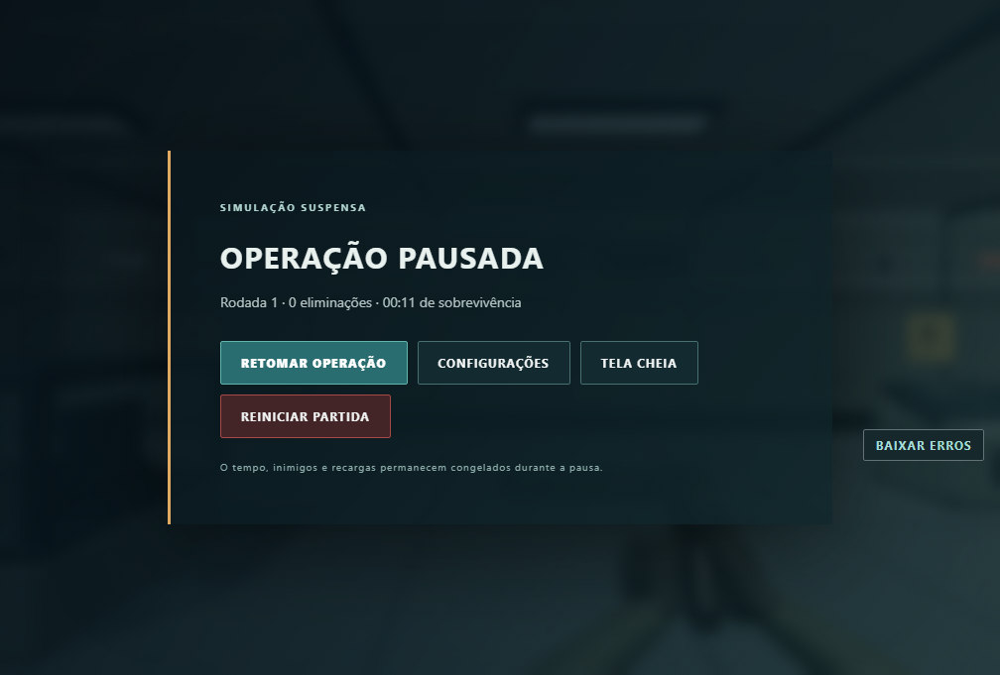

# Desktop Test Build — Windows x64

## Base e revisão

- Base visual preservada: `m8.1.4-containment-optimization`, commit `a048fb4acdc29186cdfb2050f8556959ecb751b7`.
- Branch: `desktop-windows-test-build`; código desktop e driver no commit `5d9ea51`. Não houve merge, rebase ou sobrescrita da `main`.
- [PR #11](https://github.com/mestre-pogramador-ai/PROTOCOLDEADZONE/pull/11), baseado em M8.1.4.
- PRs visuais pendentes: #6 → #7 → #8 → #9 → #10. Este trabalho depende de #10; deve ser revisado nessa ordem.
- Nenhuma alteração nos atributos, mapas, combate, economia, perks, IA ou controladores Rapier. A versão web continua disponível pelos comandos existentes.

## Implementação

- Electron 45.3.1 e electron-builder 26.18.0, com versões transitivas registradas no lockfile.
- `electron/main.cjs`: janela nativa, menu Jogo, F11 para alternar tela cheia, fechamento e instância única.
- `electron/policy.cjs` e `electron/assets.cjs`: origem local segura `pdz://game`, leitura direta dos arquivos empacotados no ASAR, MIME explícito e proteção contra escape de caminhos.
- `dist/` contém aplicação, GLBs e texturas locais. Rapier compat inclui o WASM no bundle; áudio existente continua sintetizado pelo jogo. Não há servidor Vite no executável.
- Renderer sem Node, sem preload privilegiado, com isolamento de contexto e sandbox. Navegação externa, popups, webviews e requisições HTTP/HTTPS são bloqueados. CSP permite somente código local, WASM e Blobs necessários às texturas e aos relatórios.
- A aceleração GPU permanece habilitada; não foram adicionadas flags de desativação.
- BAIXAR ERROS e F9 continuam usando o JSON existente; Electron oferece diálogo nativo para salvar. F8 mantém o marcador de diagnóstico. Somente a exportação local com nome esperado é permitida.
- `electron-builder.yml`: Portable x64 e instalador NSIS x64. Não há assinatura de código nesta versão de teste.

## Download e execução

1. Abra [Actions — Windows Desktop Test Build](https://github.com/mestre-pogramador-ai/PROTOCOLDEADZONE/actions/workflows/desktop-windows.yml).
2. Escolha uma execução verde da branch `desktop-windows-test-build` (ou do PR após integração), baseada no commit desejado.
3. Entre na sua conta GitHub e, em **Artifacts**, baixe `PROTOCOL-DEAD-ZONE-Windows-x64` e extraia o ZIP.
4. Execute `PROTOCOL-DEAD-ZONE-Portable.exe`, ou instale por `PROTOCOL-DEAD-ZONE-Setup-0.9.5-x64.exe`.

Destino: Windows 10/11 de 64 bits. A falta de certificado pode gerar aviso de editor desconhecido/SmartScreen; verifique a origem e o commit do artifact. Não é necessário instalar Node, Vite ou baixar assets durante a partida. A extração inicial do Portable pode levar alguns segundos.

- F11: tela cheia opcional; Esc: pausa/liberação do mouse conforme o jogo.
- Mouse/WASD: controles existentes; clicar para iniciar/retomar obtém Pointer Lock.
- F8: marcar problema; F9 ou BAIXAR ERROS: escolher destino do relatório JSON.
- Alt permite acessar o menu nativo oculto automaticamente; Jogo → Sair fecha o processo.

## Reprodução dos builds

```sh
npm ci
npm test
npx tsc -b
npm run test:motion
npm run build
npm run desktop:build
```

Os EXEs ficam em `release/`. O build Windows é validado no runner Windows do workflow `.github/workflows/desktop-windows.yml`. `npm run desktop:pack` gera uma pasta não instalada para o sistema operacional atual. `npm run desktop:start` abre o `dist/` já compilado sem Vite. `npm run test:desktop` abre Electron; para testar o pacote, configure `DESKTOP_EXECUTABLE` para o executável em `release/win-unpacked/`.

O workflow executa instalação, testes, TypeScript, movimento, build web, empacotamento Windows e smoke do EXE. Quando o empacotamento termina, preserva os EXEs como artifacts mesmo se o smoke falhar, para investigação; consulte sempre o status da execução. Somente uma execução verde constitui aprovação automatizada. O artifact separado `desktop-smoke-evidence` preserva logs mesmo quando o smoke falha. Não publica automaticamente releases ou sites. O acionamento manual por `workflow_dispatch` fica disponível após o workflow estar registrado na branch padrão; o PR já executa a validação automaticamente.

## Validação realizada

Execução aprovada: [Windows CI #43165153199](https://github.com/mestre-pogramador-ai/PROTOCOLDEADZONE/actions/runs/43165153199), commit `5d9ea51`. O commit posterior de documentação preserva exatamente o código validado.

| Verificação no Windows Server 2025 | Resultado |
| --- | --- |
| `npm ci` | Aprovado |
| `npm test -- --maxWorkers=2 --testTimeout=30000` | 187 aprovados / 0 reprovados, 29 arquivos |
| `npx tsc -b` | Aprovado |
| `npm run test:motion` | 13 aprovados / 0 reprovados |
| `npm run desktop:build` (inclui build web) | Portable x64 + NSIS x64 gerados |
| `npm run test:desktop` | 1 cenário aprovado / 0 reprovados; etapa final `passed` |

O smoke iniciou a operação pelo menu real, verificou chão Rapier e deslocamento por W, disparo com mouse (15/90 → 14/90), recarga por R (15/89), Pointer Lock, pausa e tela cheia F11. Confirmou `window.require` e `window.process` ausentes, WebGL 2 disponível, menu nativo e saída normal com código 0. F8/F9 e BAIXAR ERROS produziram JSONs completos (19 e 20 entradas nesta execução), com marcador F8 verificado. O destino foi selecionado pelo driver; não se afirma teste manual do diálogo.

Foram capturadas 16 requisições locais (`pdz://game` e Blobs dessa origem), **0 erros de console/JavaScript/HTTP ≥400** no monitor do renderer. O renderer real foi `ANGLE (Microsoft, Microsoft Basic Render Driver (0x0000008C) Direct3D11 vs_5_0 ps_5_0, D3D11)`: software, com WebGL 2.0. Não houve medição de FPS ou validação em GPU física.

Evidências:

- [Executáveis Windows — artifact 13920062181](https://github.com/mestre-pogramador-ai/PROTOCOLDEADZONE/actions/runs/43165153199/artifacts/13920062181), ZIP de 249.304.317 bytes.
- Tamanhos e SHA-256 dos dois EXEs baixados e conferidos estão em [`windows-artifacts.json`](docs/validation/desktop/windows-artifacts.json). Os binários não foram adicionados ao Git.
- [Evidências completas da CI — artifact 13920461027](https://github.com/mestre-pogramador-ai/PROTOCOLDEADZONE/actions/runs/43165153199/artifacts/13920461027).
- [`docs/validation/desktop/windows-validation.log`](docs/validation/desktop/windows-validation.log): resumo dos logs reais de testes, builds e estágios.
- [`result.json`](docs/validation/desktop/result.json), [`network-and-errors.json`](docs/validation/desktop/network-and-errors.json), [`diagnostics.json`](docs/validation/desktop/diagnostics.json) e [`button-diagnostics.json`](docs/validation/desktop/button-diagnostics.json).
- Captura automatizada do menu de pausa, inspecionada: interface legível e botão BAIXAR ERROS visível. Não equivale a jogar o FPS manualmente.



Validação adicional local:

- Instalação local concluída usando proxy/cache gravável do ambiente. As primeiras tentativas falharam por acesso direto ao download e cache somente leitura; não houve alteração de certificados ou desativação de TLS.
- Testes locais: **187 aprovados, 0 reprovados**, em 29 arquivos, incluindo integração existente de Rapier, combate, IA, compras, perks, progressão e descarte.
- `npx tsc -b`: aprovado.
- `npm run test:motion`: **13 aprovados, 0 reprovados**.
- Build web e `npm run desktop:pack`: aprovados; pacote Linux gerado como verificação adicional do pipeline. O aviso de chunk acima de 500 kB permanece (bundle principal ~3,66 MB antes de gzip); não foi ocultado.
- Logs locais preservados em `docs/validation/desktop/`. Inspeção do ASAR Linux confirmou os oito GLBs locais e os três módulos Electron dentro do pacote.
- Inicialização gráfica Linux: bloqueada pela ausência de X server/`$DISPLAY`; não foi declarada validação visual local.

## Problemas encontrados e corrigidos

- Assets relativos/absolutos do jogo precisam de uma origem estável: protocolo local mantém as URLs existentes sem alterar os sistemas de gameplay.
- Requisições internas `file://` entrariam em conflito com o bloqueio de rede: substituídas por leitura direta do ASAR e respostas com MIME explícito.
- Testes de integração com 20 infectados excederam o limite padrão de 5 s na VM Windows: CI usa 30 s por teste, preservando as mesmas asserções.
- Playwright usa sandbox desabilitado por padrão no launcher Electron: smoke configura `chromiumSandbox: true`; produto também mantém sandbox ativo.
- A primeira execução do EXE encontrou bloqueio CSP ao carregar texturas embutidas dos GLBs. `connect-src` passou a permitir Blobs; o filtro da sessão continua limitando-os à origem local.
- A checagem inicial de F11 falhou no driver CDP. O smoke passou a enviar F11 por `webContents.sendInputEvent`, exercitando o handler nativo do Electron, e aguardar a transição de tela cheia. A execução Windows #43160053570 confirmou entrada em tela cheia.

- O smoke anterior deixou a simulação ativa durante as operações nativas e chegou ao estado de morte antes de procurar o menu de pausa (43 s de sobrevivência). Disparo, recarga e F11 já tinham passado. O driver agora pausa antes das operações da janela, sem alterar IA/dano/tempo. A execução #43161147451 confirmou o menu de pausa (17 s de sessão) e tela cheia; ficou bloqueada na exportação por F9. A entrada nativa resolveu a automação das teclas F8/F9 na execução #43162348882, que chegou à etapa `passed`, mas terminou vermelha por um erro posterior do driver. Evidência da falha: `docs/validation/desktop/smoke-timing-failure.png`.

- O Playwright já havia desconectado ao final do fechamento normal; consultar `app.process()` novamente na limpeza causava exceção. O driver agora guarda a referência ao processo ao iniciar e consulta essa referência após a saída.
- A existência do arquivo exportado não garante que o download terminou. O driver passou a aguardar o evento `done: completed` do Electron antes de ler os dois JSONs e fechar a janela. A execução #43163553291 confirmou a persistência dos dois relatórios.
- O driver mantinha a sessão Node Inspector aberta ao aguardar a saída do processo. O encerramento oficial `app.close()` do Playwright desconecta essa sessão de depuração, após solicitar fechamento normal. O teste usa esse fluxo e continua exigindo saída com código 0, sem matar o processo à força.

## Limitações

- O runner hospedado executa Windows Server 2025; não substitui teste manual em Windows 10/11 físico, instalação/desinstalação, antivírus, múltiplos monitores e diferentes escalas DPI.
- Smoke usa o EXE empacotado não instalado (`win-unpacked`). A execução do wrapper Portable e a interface do instalador precisam de validação adicional em uma máquina Windows de teste.
- Exportação automatizada escolhe o destino por API do driver; o diálogo nativo de seleção do arquivo deve ser conferido manualmente.
- Não se afirma aprovação artística, jogabilidade manual nem 60 FPS. O renderer observado é Microsoft Basic Render Driver/D3D11 (software); a aceleração GPU do aplicativo permanece no padrão habilitado. O resultado não é benchmark em GPU física.
- Audição, sensação de mira/mouselook e dispositivos de entrada específicos precisam de teste manual.
- O check externo Vercel no PR informa `Deployment was blocked`. Ele é separado da validação desktop; permissões/hospedagem Vercel não foram alteradas.
- Não foi iniciado nenhum setor novo. Próxima etapa: revisão do PR e teste assistido dos dois formatos em Windows 10/11.
