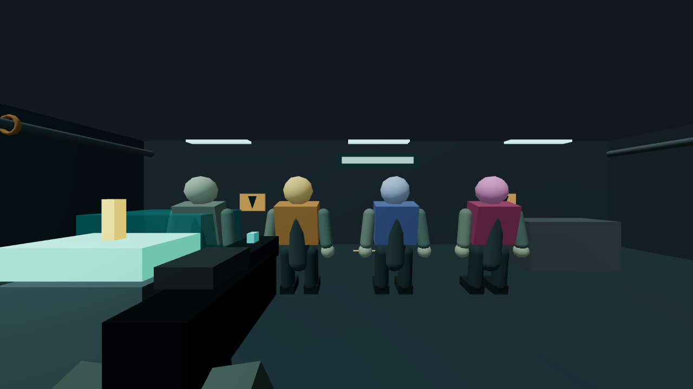
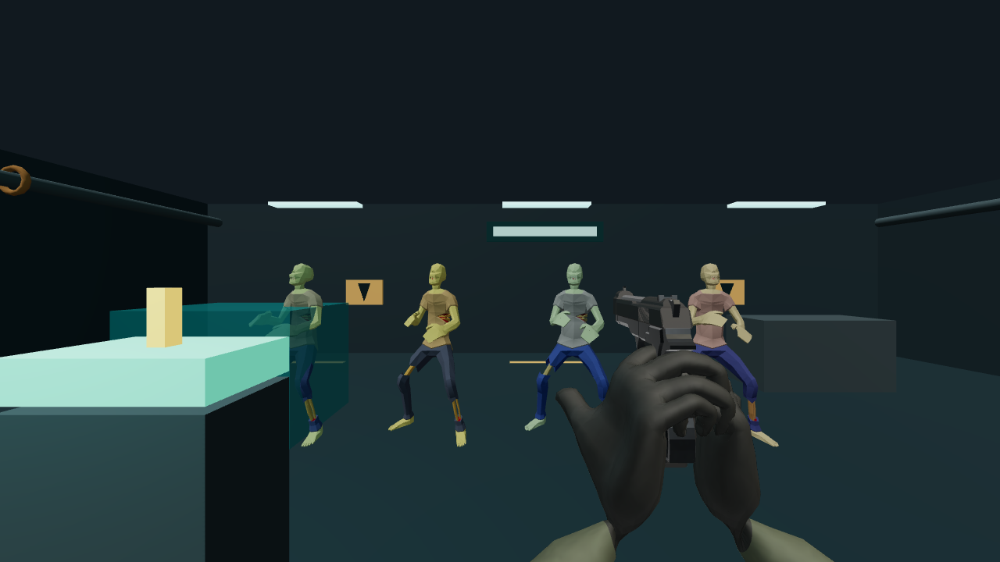

# M8.1.1 — Relatório visual e técnico

Data: 9 de novembro de 2026 (UTC). Status: **implementação integrada na branch,
testada; aceite de arte e desempenho pendentes**. M8.2 não iniciado.

## 1. Base, preservação e revisão

- `origin/main`: `12afa634bb213ea550c762ba2f7b662ad1a34854`, merge do M7.1/PR #5.
- M8.1: `4be7f92b9e2c7db3e6c0f9bbd7ff3c35a14ec34c`, branch `m8.1-perks`,
  [PR #6](https://github.com/mestre-pogramador-ai/PROTOCOLDEADZONE/pull/6) ainda aberto
  na verificação desta entrega. Portanto, M8.1 **ainda não consta na main**.
- Branch desta entrega: `m8.1.1-visual-overhaul`, descendente integral do M8.1.
  Revisão empilhada sobre `m8.1-perks`; integrar #6 primeiro e depois revisar
  esta atualização. Nenhum force-push, rebase destrutivo ou merge em main.
- Commits: `7029338` auditoria/plano; `868b3b1` assets e pipeline;
  `7d50e6b` renderização; `4dfe67e` testes e fixtures.
  As execuções finais usam esse código e os metadados de versão `0.9.2`.
  Relatório, evidências e metadados são registrados no commit de documentação.
- Sem mudanças em atributos de M9/infectados, regras de IA, hitboxes, física,
  economia, perks, recompensas ou rodadas. Runtime recebe somente um getter
  de leitura do timing existente para a apresentação acompanhar o GameClock.
  Não houve publicação em produção.

## 2. Auditoria anterior e evolução verificável

A auditoria foi registrada antes da implementação em
[M8_1_1_VISUAL_PLAN.md](M8_1_1_VISUAL_PLAN.md).
M9Viewmodel usava caixas/cilindros, sem mãos anatômicas ou carregador móvel.
InfectedView montava cada ator com caixas, cápsulas e esferas, sem skin/mixer.
Não havia GLB, texturas ou clips locais. Os arquétipos existentes são somente
**common, runner, brute e predator**; não foi acrescentado um quinto tipo.

Agora a arma e os corpos usam meshes reais de bibliotecas licenciadas,
carregadas localmente. Braços/mãos possuem skin e dedos; o infectado possui
anatomia humanoide e clips. Os materiais e a leitura das silhuetas melhoraram,
mas os assets continuam estilizados/low poly e **provisórios para direção de arte**.
Não são apresentados como arte militar realista finalizada.

Comparação com mesma câmera, sala, resolução 1280×720 e posições de atores:

| Antes | Depois |
| --- | --- |
|  |  |

Outras capturas: [ADS estabilizado](docs/validation/M811/visual/ads.png),
[recarga](docs/validation/M811/visual/reload.png),
[corrida](docs/validation/M811/visual/sprint.png),
[ataque](docs/validation/M811/visual/active.png),
[morte](docs/validation/M811/visual/dead.png),
[FOV 100 e 4:3](docs/validation/M811/visual/fov100-4x3.png),
[20 infectados dentro da sala](docs/validation/M811/visual/valid-room-twenty.png).
São screenshots de Chromium automatizado, inspecionadas graficamente;
não representam uma sessão de FPS jogada manualmente.

## 3. Assets, fontes e licenças

| Asset local | Fonte / licença | Bytes | Triângulos | Rig / animação |
| --- | --- | ---: | ---: | --- |
| `models/weapons/m9.glb` | [Quaternius — 9mm Pistol](https://poly.pizza/m/BoZWhFdsj4), CC-BY 3.0 | 362.552 | 3.066 | Frame, Slide, Trigger, Hammer, Magazine separados |
| `models/viewmodels/tactical-arms.glb` | [para / MakeHuman — FPS arms](https://opengameart.org/content/fps-arms-rigged-only), CC0 1.0 | 467.732 | 8.152 | 51 joints; SupportReload |
| `models/characters/infected.glb` | [Quaternius — Animated Zombie](https://poly.pizza/m/jkrEvQZb8J), CC-BY 3.0 | 694.500 | 2.116 | 41 joints; Idle/Walk/Run/Bite/Crawl |
| `models/characters/infected-lod.glb` | Derivado autorizado do anterior, CC-BY 3.0 | 138.796 | 761 | Mesmo rig; reutiliza clips do principal |

Os caminhos são relativos a `public/assets/`. Inventário verificável com hashes,
texturas, primitives, joints, clips e status:
[visual-assets.json](public/assets/manifests/visual-assets.json).
Download original, URLs e SHA256:
[sources.json](public/assets/manifests/sources.json).
Autores, modificações, links oficiais e cópias dos termos:
[ATTRIBUTION.md](public/assets/manifests/ATTRIBUTION.md).
A interface oferece o link de créditos nas configurações.

Os GLBs da pistola e do infectado foram baixados efetivamente dos endpoints
públicos da biblioteca. O arquivo CC0 de braços foi baixado como `.7z`, com
fontes Blender/FBX, e convertido localmente no Blender 4.3.2.
A licença adotada para Quaternius é a **CC-BY 3.0 indicada nas páginas específicas**,
sem presumir CC0 a partir de outros packs do autor. Não foram usados modelos
extraídos de jogos proprietários. Os textos legais locais vieram do espelho SPDX;
links oficiais permanecem nos créditos.

Adaptações: escala/eixos, UVs, bevels e PBR na pistola, carregador original
adicionado, pose/luvas/mangas e bake de recarga nos braços, retarget visual
e LOD do infectado. Cinco texturas originais 256×256 de metal/borracha/tecido
estão em `public/assets/textures/` e embutidas nos GLBs. O infectado preserva
a textura original embutida. Não há download remoto essencial durante a partida.

Pipeline recuperável em `tools/fetch-visual-assets.py`,
`prepare-visual-assets.py`, `prepare-infected-lod.py` e
`inventory-visual-assets.py`. `py7zr`/Blender são ferramentas offline;
nenhuma dependência nova foi adicionada ao runtime do jogo.

## 4. Viewmodel, materiais e animações

- Cena/câmera FPS próprias, FOV 55°, aspect atualizado e near 0,01 m.
  Mundo e HUD usam os sistemas existentes. Pose visual nunca modifica raio
  hitscan, colisão, munição, dano ou rotação autoritativa da mira.
- Idle com respiração, Walk com balanço, Sprint abaixando a arma,
  Fire com recuperação/ferrolho/gatilho, ADS suave e Equip por eventos de sessão.
- Reload separa deslocamento do carregador e clip esquelético da mão de apoio.
  Ambos observam a duração/progresso do ReloadController, inclusive Mãos Rápidas.
  Animações não concedem munição. O controle existente mantém toda transação.
- Dois braços anatômicos, dedos reposicionados, luvas foscas e mangas verdes.
  A adaptação afasta vértices internos de um envelope conservador da empunhadura;
  isso não certifica ausência de interpenetrações em todas as poses.
- Metal, polímero e tecido têm materiais PBR diferentes; iluminação e ambiente
  local de reflexão do viewmodel evitam a dependência de HDR remoto/bloom.
  Sala/iluminação global e orçamento de sombras anteriores foram preservados.
  Flash, tracer e ponto de impacto continuam VFX simples, sem mudar precisão.

Infectados usam SkeletonUtils.clone e AnimationMixer por ator, com geometria
e textura compartilhadas. Idle/Walk/Run/Bite representam os estados da IA;
windup/active/recovery posicionam o clip pelo timer autoritativo. Translação
horizontal dos quadris é removida para impedir root motion independente.
Reação ao tiro é um clip procedural curto. Como o original não contém morte,
`Collapse_from_Crawl` adapta uma pose baixa do Crawl e a congela: **não é um
clip de morte original nem um novo comportamento de rastejamento**.

Comum usa base pálida; Corredor usa tom quente, largura menor e Run;
Brutamontes usa tom frio/largura maior e Walk; Predador usa tom avermelhado e Run.
Todos preservam a altura e os volumes de gameplay. A diferenciação é inicial:
não há quatro modelos/figurinos exclusivos nem blindagem militar detalhada.

## 5. Problemas encontrados e corrigidos

| Problema reproduzido | Causa e correção | Verificação |
| --- | --- | --- |
| Peças da M9 quase invisíveis após conversão | Alterar o pai antes dos filhos eliminava escala FBX 100×; capturar todas as matrizes mundiais antes de transformar | Bounds reais e assertions de comprimento de Slide/Trigger/Hammer; screenshots |
| LOD gigante à distância | Espaços de bind distintos apesar de node scales semelhantes; converter geometria pelas inverse bind matrices e remapear bone indices por nome | Teste unitário sintético e altura 1,4–2,5 m de cada ator no browser |
| Cabeça fora da coluna de headshot com postura importada | Ajustar orientação visual da coluna e escala, sem alterar hitboxes | Tolerância do centro em idle e dois headshots pelo combate real |
| Queda rígida atravessava o chão em cerca de 0,4 m | Animação global inadequada ao rig; substituída por pose dobrada do clip existente, com ajuste vertical | Bounds deformados de quatro cadáveres >= -0,04 m; execução final cerca de +0,006 m |
| Arquivos relativos retornavam 404 nas fixtures em subdiretórios | Base documental das páginas de teste divergente do app; adicionar `<base href="/">` nas fixtures | Carregamento dos quatro GLBs, texturas embutidas e zero HTTP >=400 no smoke/visual |
| Risco de promessa rejeitada/cache ou runtime abandonado na inicialização | Evicção de falhas, preflight do bundle antes do runtime e cleanup idempotente | Testes de retry/refcount/descarte e browser sem rejeições |
| Recursos compartilhados sujeitos a descarte antecipado | Refcount, grace period para StrictMode, clones de skeleton e cleanup individual | Testes de última liberação, Texture/ImageBitmap.close, três ciclos de reset |
| Screenshot ADS ainda durante Equip em renderização lenta | Espera baseada apenas em ADS/wall time; aguardar tempo de simulação antes da captura estabilizada | Screenshot final ADS com miras, sem confundir transição com pose final |
| Tipos de `import.meta.env` ausentes | Adicionar declaração de tipos Vite | TypeScript e build |

Durante a escrita dos testes também foram corrigidos um erro sintático inicial,
um limiar de triângulos que desconsiderava o LOD e uma expectativa de BASE_URL
que usava o default do Vitest em vez de um prefixo explícito. Os contratos finais
verificam os arquivos reais, não números de um placeholder.

## 6. Comandos e resultados efetivamente executados

| Comando | Resultado final |
| --- | --- |
| `npm ci` | Exit 0; 124 pacotes instalados |
| `npm test` | **151 aprovados, 0 reprovados**, 23 arquivos; 12 testes novos M8.1.1 |
| `npx tsc -b` | Exit 0, sem erros TypeScript |
| `npm run build` | Exit 0; 95 módulos; JS ~3,64 MB / ~1,24 MB gzip |
| `npm run test:motion` | **13 verificações aprovadas, 0 reprovadas** |
| `node tools/build-visual-fixture.mjs` + `node tools/validate-visual-browser.cjs` | 13 grupos de evidências; zero erros JS/HTTP |
| `node tools/validate-m71-browser.cjs` | Smoke de produção: início, tiro, recarga, munição, créditos, rodadas, pausa/reset e diagnóstico |
| `node tools/build-perk-fixture.mjs` + `node tools/validate-m81-browser.cjs` | Regressão de máquinas/perks e HUD, com créditos semeados na fixture |

Rapier real é exercitado pela suíte: movimento/chão/parede, multidões/IA,
Runtime/combat, perks e progressão R1–10. Os testes M7.1 de recursos finitos e
Runtime permanecem, incluindo tiros, acertos/misses, recargas e compras pagas.
Não foram substituídos por eliminações diretas para validar a progressão.

Logs integrais e ambiente: [docs/validation/M811/logs/](docs/validation/M811/logs/).
Avisos remanescentes: inicialização de Rapier-compat imprime depreciação da
assinatura interna; Vite avisa sobre chunk >500 kB. Não são falhas do build.
Blender avisa sobre configuração de usuário somente leitura e Draco ausente;
a exportação GLB sem compressão foi bem-sucedida e não exige decoder Draco.

## 7. Chromium e alcance das evidências

Builds de produção servidos por Vite Preview: app 4173, fixture perks 4174,
fixture visual 4175. Chromium headless usa SwiftShader, DPR 1.
Playwright foi instalado no ferramental temporário `/tmp/protocol-browser`,
invocado com `NODE_PATH=/tmp/protocol-browser/node_modules`.
Scripts de regressão usam `EXPECTED_REPORT_VERSION=M8.1.1` e diretórios
`M71_EVIDENCE_DIR`, `M81_EVIDENCE_DIR`/`VISUAL_EVIDENCE_DIR` para os resultados.

Evidência visual estruturada: [visual/result.json](docs/validation/M811/visual/result.json).
Foram carregados os quatro GLBs, testados LOD, estados/poses, ADS, Equip,
Sprint/Walk, FOV/aspect, recarga e três resets; sem erros de console/HTTP.
Dois cliques do mouse executaram **dois tiros e dois headshots**, gastaram
15→13 balas, eliminaram um Comum e concederam 110 CR. Depois o cadáver foi
removido pelo ciclo real e a recarga deixou 15/88. A animação não criou balas.

A fixture visual posiciona atores, controla poses e desativa o scheduler de
rodadas para tornar screenshots reproduzíveis. Na etapa dos tiros, a mira é
calculada sobre a posição do alvo e o caminho normal de combate é utilizado;
não chama applyDamage/kill para eliminar o alvo. Isso valida integração de
hitscan/dano/ammo, sem certificar habilidade humana de mira/movimentação.
Não equivale a jogar as rodadas 1–15 manualmente.

Smoke normal: [production/result.json](docs/validation/M811/production/result.json).
Perks/HUD: [perks/result.json](docs/validation/M811/perks/result.json).
O smoke normal não injeta créditos ou kills. O cenário de perks semeia saldo
somente na fixture separada, que não é a entrada do deploy normal.
F8/F9 e BAIXAR ERROS produzem relatórios M8.1.1; zero erros graves observados.

## 8. Desempenho efetivamente medido

Medidas curtas (~3 s por amostra) de intervalos RAF no Chromium/SwiftShader,
1280×720, DPR 1. FPS = 1000/média dos intervalos, sem extrapolar para GPU real.
Baseline: [before/metrics.json](docs/validation/M811/before/metrics.json).
Depois: [visual/result.json](docs/validation/M811/visual/result.json).
Chamadas e triângulos agregam mundo + viewmodel; incluem passes de sombras.

| Cenário | Amostras | Média ms | FPS medido | Draw calls | Triângulos | Geometrias / texturas |
| --- | ---: | ---: | ---: | ---: | ---: | ---: |
| Antes, 4 estáticos | 26 | 113,37 | 8,82 | 94 | 8.698 | 104 / 1 |
| Depois, 4 estáticos | 16 | 181,96 | 5,50 | 61 | 28.788 | 47 / 14 |
| Antes, 20 em grade comparável | 21 | 137,72 | 7,26 | 334 | 41.210 | 344 / 1 |
| Depois, 20 na mesma grade | 12 | 215,43 | 4,64 | 81 | 54.848 | 48 / 30 |
| Depois, 20 com animação nessa grade | 13 | 228,10 | 4,38 | 81 | 54.848 | 48 / 30 |
| Depois, 20 com animação dentro da sala | 12 | 242,17 | 4,13 | 89 | 82.616 | 48 / 30 |

A grade comparável inclui atores distantes atrás da parede norte, como no
baseline; por isso foi acrescentado um cenário totalmente dentro da sala.
Não se deve comparar o último diretamente com o baseline como cena idêntica.
Os clips e a orientação do novo rig diferem do boneco antigo.

**Houve regressão do tempo de frame por software**, mesmo com redução de calls
e geometrias. Skinning, texturas e apresentação mais complexa aumentam o custo;
isso ainda não foi isolado em profiling de GPU. Não foi comprovada a meta de
60 FPS. As amostras são pequenas e não constituem benchmark estatístico.

Mitigações implementadas: assets/cache únicos, geometrias/texturas compartilhadas,
LOD de 761 triângulos acima de 7 m, sombras desativadas à distância, um material
por infectado e scratch objects reutilizados. Cache mantém recursos entre resets.
Três ciclos 20→0 repetiram exatamente **51→49 geometrias e 30→9 texturas**,
após aquecimento de efeitos. Não foi observado crescimento nesses contadores;
isso não comprova ausência de todos os vazamentos de heap ou de longa duração.
O cleanup cobre material/geometry/texture/ImageBitmap e descarte de skeleton/mixer.

## 9. Limitações e prioridades pendentes

1. **Desempenho:** medir numa GPU desktop real e traçar CPU/GPU com 20 atores;
   investigar a regressão antes de liberar como atualização de qualidade final.
2. **Empunhadura/animação:** revisão artística dos dedos, polegares, contato com
   gatilho, suporte e recarga em todos os ângulos. Luvas são adaptação de material,
   não um modelo novo com equipamento/painéis detalhados. Não há IK de contato
   em runtime nem garantia automatizada de interseção zero em toda a malha.
3. **Infectados:** roupas/equipamentos distintos por arquétipo e morte dedicada.
   A adaptação Crawl é provisória. Foot planting, stride e alinhamento de partes
   extremas com as hitboxes exigem revisão em movimento; não há IK dos pés.
   O teste do centro de cabeça idle não certifica cada vértice em cada pose.
4. **Materiais/arte:** assets low poly e texturas simples ainda não atingem a
   referência de FPS militar realista. Desgaste detalhado, armadura, VFX e revisão
   de luz da Sala de Contenção permanecem trabalho de arte, sem inventar mecânicas.
5. **Infraestrutura:** dividir o chunk de produção e revisar warning de Rapier
   em tarefa apropriada; nenhum upgrade de física foi feito neste escopo visual.
6. **Validação humana/entrega:** jogar o FPS em hardware real, testar FOV/resoluções
   adicionais e endurance. A nuvem permitiu inspeção de screenshots e automação,
   mas não controle manual de gameplay nem validação de latência numa GPU desktop.
   Deploy de produção não executado; aprovação de serviços de hospedagem/autor
   não é demonstrada por testes locais.

## 10. Recomendação sobre M8.2

Manter esta entrega em revisão como evolução visual verificável e recuperável.
**Não iniciar automaticamente M8.2**: concluir a revisão do M8.1/PR #6, avaliar
a empunhadura/morte/variantes com direção de arte e medir/corrigir desempenho
em GPU real. Build, regressões e carregamento passaram; esses resultados não
equivalem ao aceite visual final nem à comprovação de 60 FPS.
