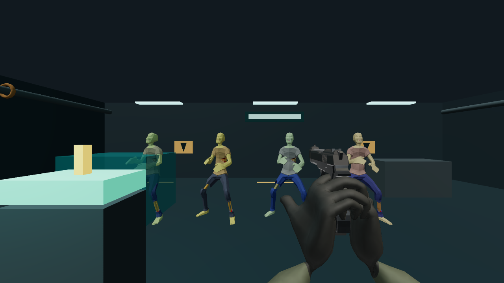
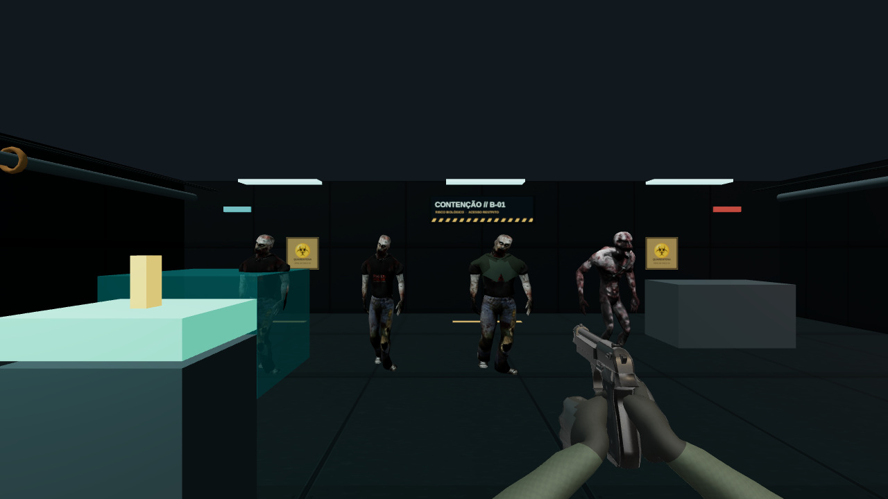
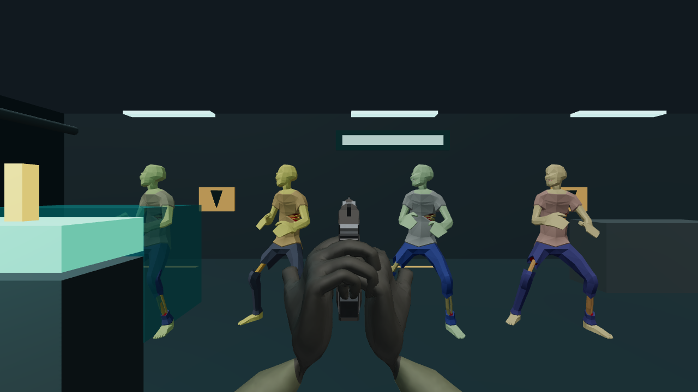
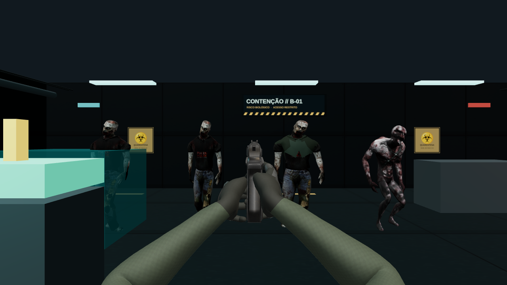

# M8.1.2 — Visual Quality Upgrade

Data: 9 de novembro de 2026, UTC. Versão: `0.9.3`.
Status: **evolução visual implementada e demonstrada em capturas; revisão de
arte, animação fina e desempenho em GPU desktop pendentes**. Não é uma declaração
de arte final nem de 60 FPS. M8.2 não iniciado.

## 1. Base e auditoria inicial

Branch: `m8.1.2-visual-quality`, baseada no M8.1.1 `1218827`.
Na consulta final, `origin/main` permanece em `12afa63` (merge M7.1).
M8.1/[PR #6](https://github.com/mestre-pogramador-ai/PROTOCOLDEADZONE/pull/6) e
M8.1.1/[PR #7](https://github.com/mestre-pogramador-ai/PROTOCOLDEADZONE/pull/7)
continuam abertos. Esta entrega preserva todos os commits e deve ser revisada
sobre o M8.1.1; não foi feito merge em main ou deploy de produção.

Commits da implementação: `38050dc` auditoria; `492318d` assets/pipeline;
`a2dd1d3` apresentação; `ad16f0e` testes. O código validado corresponde a esses
commits; relatório/evidências são registrados separadamente na documentação.
Revisão entregue em [PR #8 — rascunho](https://github.com/mestre-pogramador-ai/PROTOCOLDEADZONE/pull/8),
base `m8.1.1-visual-overhaul`. O commit `87b5ca7` reúne as evidências da entrega.

Auditoria anterior à implementação:
[M8_1_2_VISUAL_AUDIT.md](M8_1_2_VISUAL_AUDIT.md).
As imagens M811 mostravam mãos entrelaçadas/grandes sobre o ferrolho,
enquadramento hip alto, material pouco definido e quatro corpos estilizados
quase iguais. O mesh Quaternius de infectado tinha 2.116 triângulos e textura
simplificada. A morte adaptava Crawl. A sala tinha superfícies planas e sinais
sem texto. Foram mantidos o viewmodel independente, cache, GameClock,
controladores de armas e arquitetura de gameplay.

Não houve alteração em `src/gameplay`, mapa/colisores/navegação ou Runtime:
dano, cadência, precisão, recarga, HP, recompensas, compras, perks e rodadas
permanecem nos sistemas anteriores.

## 2. Modelos físicos integrados e licenças

Todos os caminhos abaixo existem em `public/assets/`. GLBs 2.0 com buffers e
imagens embutidos; nenhum asset essencial é carregado de uma URL externa.

| Arquivo | Autor / fonte verificada | Licença | Bytes | Triângulos armazenados |
| --- | --- | --- | ---: | ---: |
| `models/weapons/m9-service.glb` | [Pixel32 — textured pistol / Beretta 92](https://opengameart.org/content/textured-pistol) | CC-BY 3.0 | 884.404 | 5.994 |
| `models/viewmodels/operator-arms.glb` | [para / MakeHuman team — fonte anatômica reutilizada](https://opengameart.org/content/fps-arms-rigged-only), adaptação do projeto | CC0 1.0 | 980.508 | 8.788 |
| `models/characters/infected-worker.glb` | [Pixelhouse — zombie](https://opengameart.org/content/zombie), adaptação do projeto | CC-BY 3.0 | 1.617.332 | 5.789 |
| `models/characters/infected-hunter.glb` | [Rosswet Mobile — Thin Zombie](https://opengameart.org/content/thin-zombie-awake-zombie-asset) | CC-BY 3.0 | 1.376.376 | 5.010 |

O worker contém LOD0 **3.574**, LOD1 **1.858** e colete/placas **357** tris.
O hunter contém LOD0 **3.340** e LOD1 **1.670**. Somente um LOD de corpo é
desenhado por ator. Os braços têm 51 joints e 636 tris de painéis ajustados
ao mesh; o worker tem 44 joints e o hunter 42.

Arquivos essenciais somam **4.858.620 bytes**. Inventário com hashes, nomes de
texturas, clips, joints, origem e status:
[visual-assets-m812.json](public/assets/manifests/visual-assets-m812.json).
Downloads reais e SHA256 dos ZIPs:
[sources-m812.json](public/assets/manifests/sources-m812.json).
Créditos completos e cópias dos termos:
[ATTRIBUTION.md](public/assets/manifests/ATTRIBUTION.md).
O crédito Pixelhouse inclui o link solicitado pelo autor.

Os arquivos originais foram efetivamente baixados; o script de download foi
executado novamente e confirmou hashes/extraiu os três ZIPs. Os braços não são
um novo asset externo: a anatomia CC0 foi reprocessada com outra pose e novos
detalhes. Rigs alternativos NetSirK/J-Toastie foram pesquisados/baixados, mas
não adotados por serem mais estilizados. A Beretta 93r foi avaliada por página
e preview, sem ser apresentada como modelo baixado/integrado.

Os próprios autores disponibilizaram os modelos nas bibliotecas. Não foram
extraídos assets protegidos de jogos comerciais. Texturas/painéis de luva,
colete e sinalização originais do projeto são CC0. GLBs M811 e seus créditos
foram preservados como histórico, mas estão fora de `MODEL_PATHS` ativo.

Pipeline executável e ferramentas offline:
[ASSET_PIPELINE_M812.md](docs/ASSET_PIPELINE_M812.md).
Nenhuma dependência de conversão foi adicionada ao runtime.

## 3. M9, braços e enquadramento

A pistola estilizada foi substituída por uma Beretta 92 texturizada, com UVs,
ferrolho, cano, guarda-mato, gatilho, carregador, martelo, miras, parafusos e
empunhadura legíveis. Peças móveis são nodes separados. A conversão aplica
escala métrica, bevels moderados e normais ponderadas; metal fosco e polímero
usam roughness/metalness diferentes e a textura original de desgaste.

Os punhos foram reorientados para a linha do cabo. Os dedos articulados foram
reposicionados, inclusive o metacarpo do indicador. A escala dos braços mudou
de 0,10 para 0,075 no processamento da fonte, sem alterar a arma/gameplay.
A projeção de vértices contra uma caixa, usada no M811, foi removida.
Painéis de reforço seguem a superfície anatômica e os mesmos pesos de skin,
com UVs e materiais de tecido/couro. Mangas continuam até fora da tela.

O hip fica na região inferior lateral. O ADS combina translação e inclinação
pela linha de mira medida no asset. A câmera do viewmodel permanece separada,
FOV 55°, com enquadramento adaptado ao aspect; FOV de mundo e hitscan não
recebem offsets da animação. A matriz de projeção só é atualizada quando muda
o tamanho/FOV necessário, em vez de recalcular valores idênticos por frame.

No Chromium, as mãos projetadas em ADS mediram **55,8%–72,0% da altura da
pistola**, ficaram abaixo da linha das miras e não esconderam seu ponto central.
Foram verificadas nove combinações: 4:3, 16:9 e 21:9 × FOV 70, 85 e 100.
Marcadores reais do arquivo ficaram dentro do limite de 0,015 NDC do centro;
as screenshots complementam essa verificação matemática. Não é uma prova de
contato perfeito de cada triângulo dos dedos em todas as poses.

## 4. Animações, infectados e preservação do combate

| Elemento | Implementação ativa |
| --- | --- |
| M9 Idle/Walk/Sprint | Respiração/balanço discretos e postura abaixada, curvas suaves de apresentação |
| ADS/Equip | Transição pelo adsBlend existente e eventos de sessão; câmera independente |
| Fire | Recuo/recuperação, ferrolho, gatilho, flash e tracer observacionais |
| Reload | SupportReload esquelético, mão de apoio e carregador com deslocamento de 13 cm e fases compatíveis |
| Worker | Walk/Attack/Death originais; Idle derivado de pose da fonte |
| Hunter | Idle/Walk/Run/Attack/Death da fonte; Hurt também disponível no arquivo |
| Impacto em jogo | Clip procedural curto comum; o Hurt completo do hunter ainda não é retargetado para a janela atual de 0,19 s |

SupportReload tem tempo normalizado; a execução segue `reloadRemaining` e
`reloadDuration`, incluindo Mãos Rápidas. Nenhum keyframe concede munição.
As outras ações da arma são curvas procedurais: **não foram obtidos sete takes
profissionais de animação esquelética da M9**. Essa limitação permanece explícita.

Arquétipos existentes, sem novos comportamentos:

- Comum: Pixelhouse vestido, rosto/olhos/ferimentos reconhecíveis, roupa gasta,
  normal/roughness e postura assimétrica.
- Corredor: mesma base vestida, porte mais estreito, inclinação própria e
  cadência maior. Ainda compartilha rosto e roupa com o Comum.
- Brutamontes: porte mais largo e colete/placas skinnados modelados a partir
  do torso. Equipamento é adaptação inicial, não figurino militar finalizado.
- Predador: outro humanoide, magro/mutado e curvado, textura e Run próprios.

AnimationMixer observa idle/chase/windup/active/recovery/hurt/dead da IA.
O ataque é posicionado pelo timer real do estado; não causa dano pela animação.
Root motion planar é retirado. A morte original do worker, de 4,2 s, é retimada
visualmente para terminar em 2,15 s, dentro da remoção preexistente em 2,5 s.
Não foi alterado o tempo do controlador ou do cadáver.

Algumas poses importadas afastavam a cabeça do volume de headshot (por exemplo,
Predador correndo ~33 cm abaixo e ~29 cm no plano). Um retarget por rotação da
coluna corrige apenas poses fora da tolerância, sem mover quadris/pés/hitboxes.
Nas seis poses vivas amostradas, os máximos ficaram entre **3,3 e 20,7 cm**,
abaixo do limite de teste de 23,5 cm e do raio de headshot existente de 25 cm.
O teste sintético também verifica que os pés/quadris não são deslocados.
Essa amostragem não certifica cada frame de todas as transições possíveis.

A morte recebeu uma curva de contato medida no próprio Three.js: 33 amostras
de vértices deformados/indexados visíveis por arquétipo, com compensação vertical
suave e limitada. O arquivo guarda hashes dos GLBs e a medição original.
O teste final encontrou o ponto mais baixo dos cadáveres em aproximadamente
**+0,004 m em relação ao Y=0 do mapa físico** nas poses verificadas. A camada
visual do piso permanece em Y=0,016; o contato fino de solas/roupa com essa
superfície elevada ainda faz parte da revisão de arte.

## 5. Materiais e Sala de Contenção

Mapas de diffuse/normal/specular do worker foram incorporados localmente,
redimensionados a 1024 e adaptados para PBR. Roughness é derivada do mapa
especular antigo; não é uma medição física de material. Tangentes são preparadas
offline. Os outros materiais distinguem tecido, couro, metal e polímero.

A sala ganhou painéis/superfícies com juntas, fixações, desgaste e sujeira,
sinalização de contenção/risco biológico legível, cabos no teto, faixas de
emergência ciano/vermelho e sombras PCF suaves. Arte de superfície/sinalização
é original e gerada localmente com CanvasTexture; não depende de imagens remotas.
Os detalhes ficam nas paredes/teto. Colisores, rotas, porta, máquinas, estação
de munição e spawns do mapa não foram modificados.

## 6. Screenshots comparativos e evidência gráfica

| M8.1.1 | M8.1.2 |
| --- | --- |
|  |  |
|  |  |

Capturas adicionais do build de validação:
[Comum próximo](docs/validation/M812/visual/common-close.png),
[quatro arquétipos visíveis](docs/validation/M812/visual/four-archetypes.png),
[disparo](docs/validation/M812/visual/fire.png),
[recarga](docs/validation/M812/visual/reload.png),
[combate misto](docs/validation/M812/visual/multiple-combat.png),
[morte](docs/validation/M812/visual/dead.png),
[20 dentro da sala](docs/validation/M812/visual/valid-room-twenty.png),
[HUD de produção](docs/validation/M812/production/round-active.png),
[HUD com perks](docs/validation/M812/perks/four-perks.png).

As imagens foram abertas e inspecionadas. A redução das mãos, maior exposição
do ferrolho, centralização ADS, rosto/roupa texturizados e troca da silhueta do
Predador são perceptíveis. A cena “quatro arquétipos” usa posições de exibição
para evitar a estação encobrir um ator; “four” mantém a grade comparável.
Não há captura close anterior equivalente: não foi fabricado um antes de perto.
Screenshots de tiro/recarga são pausadas no instante apropriado para evidenciar
a pose. Não foi realizada sessão manual de FPS.

## 7. Testes realmente executados

| Comando / cenário | Resultado final |
| --- | --- |
| `npm ci` | Tentativa inicial falhou por cache padrão não gravável |
| `npm ci --cache /tmp/m812-npm-cache` | Exit 0; 124 pacotes instalados |
| `npm test` | **162 aprovados / 0 reprovados**, 24 arquivos; 11 testes novos M8.1.2 |
| `npx tsc -b` | Exit 0, sem erros TypeScript |
| `npm run build` | Exit 0; 99 módulos; JS 3.644,17 kB / 1.241,58 kB gzip |
| `npm run test:motion` | **13 verificações aprovadas / 0 reprovadas** |
| `validate-m812-gltf.cjs` | Quatro GLBs: **0 erros**, 10 avisos de hierarquia/transforms de skin |
| `validate-m812-browser.cjs` | 19 grupos de evidência; zero erros JS/HTTP >=400 |
| `validate-m71-browser.cjs` sobre Vite Preview | Início, HUD, tiro/recarga, compra de munição/créditos, rodada, pausa/reset, F8/F9/BAIXAR ERROS aprovados |
| `validate-m81-browser.cjs` | Quatro perks, cobrança, efeitos, reload durante compra, pausa/reset, saldo insuficiente e HUD sem sobreposição aprovados |
| `fetch-m812-assets.py` | Três fontes baixadas novamente, hashes e extração confirmados |

As suítes anteriores continuam exercitando Rapier real, colisões/movimento,
armas/IA, compras, perks, integridade de créditos e progressão com recursos
finitos. Não foram removidos testes/sistemas para obter aprovação.

O validador Khronos ainda avisa sobre meshes skinnados sob nodes com transforms;
essa hierarquia foi verificada no Three.js, mas exige cuidado ao portar os
assets para outro importador/engine. Há informações sobre nodes marcadores e
atributos não usados. Não foram ocultados avisos para declarar zero problemas.
Persistem o warning preexistente de inicialização do Rapier-compat e o aviso
Vite de chunk acima de 500 kB.

Logs, relatórios Khronos e ambiente:
[docs/validation/M812/](docs/validation/M812/).

## 8. Combate, navegador e limites da automação

Chromium headless/SwiftShader, DPR 1. Vite Preview: produção 4173, fixture de
perks 4174 e fixture visual 4175. Playwright é ferramenta temporária separada,
usada com `NODE_PATH=/tmp/protocol-browser/node_modules` e
`EXPECTED_REPORT_VERSION=M8.1.2` nos smokes anteriores.

A fixture visual desativa o scheduler de rodadas e posiciona atores para poses
reproduzíveis. No combate ela restaura a IA real e calcula a mira sobre posições
atuais, enviando mousedown/mouseup reais. Não chama kill/applyDamage para
eliminar inimigos e não injeta munição/créditos na etapa de combate.

Resultados finais:

- Alvo comum: 2 tiros/2 headshots, 15→13 balas, uma eliminação e +110 CR;
  cadáver removido pelo ciclo real; recarga concluída em 15/88.
- Combate com Comum, Corredor, Brutamontes e Predador: **9 tiros, 9 headshots,
  4 eliminações**, munição **15→6**, reserva 90 e créditos **500→950**.
  É uma batalha controlada com HP base dos arquétipos, não a rodada 10 jogada.
- Produção: tiro 15→14, recarga e complemento de munição, créditos 500→494;
  reserva cheia não cobra; reinício restaura 15/90 e 500 CR.
- Perks: saldo semeado apenas na fixture separada; compras somam 10.000 CR,
  efeitos e reset preservados. O deploy normal não usa essa entrada de teste.
- Três ciclos 20→0 retornaram aos mesmos contadores após limpeza.

Uma execução intermediária de combate falhou: a automação contava cliques
enviados antes de o render lento consumir o anterior, terminando com 3 kills,
8 tiros e um alvo vivo. A correção aguarda cada disparo confirmado, sem mudar
cadência/munição da M9. A falha foi preservada em
[attempts/multi-input-race.json](docs/validation/M812/attempts/multi-input-race.json);
a repetição final com o novo sincronismo passou.

Não foram certificadas mira/movimentação humanas, latência em GPU real ou
ausência de toda interpenetração de dedos/roupa. A carga de 20 atores é um teste
de render/animação; o combate real misto usa quatro, além das regressões de IA.

## 9. Desempenho e correções de integração

Medições de intervalos RAF por ~3 s, 1280×720/DPR 1, Chromium/SwiftShader.
O contexto confirmou `ANGLE / SwiftShader Device (Subzero)` e não havia
diretório `/dev/dri` exposto. Registro: [gpu-context.json](docs/validation/M812/logs/gpu-context.json).
FPS = 1000/média dos intervalos; amostras curtas, sem validade estatística para
extrapolar hardware desktop. Calls/triângulos incluem mundo, viewmodel e sombras.

| Cenário | Amostras | Média ms | FPS medido | Calls | Triângulos | Geometrias / texturas |
| --- | ---: | ---: | ---: | ---: | ---: | ---: |
| M811, 4 estáticos | 16 | 181,96 | 5,50 | 61 | 28.788 | 47 / 14 |
| M812, 4 estáticos | 12 | 238,58 | 4,19 | 66 | 45.534 | 51 / 23 |
| M811, 20 na grade comparável | 12 | 215,43 | 4,64 | 81 | 54.848 | 48 / 30 |
| M812, 20 na mesma grade | 10 | 280,87 | 3,56 | 96 | 97.175 | 53 / 39 |
| M812, 20 animados nessa grade | 10 | 298,54 | 3,35 | 96 | 97.175 | 53 / 39 |
| M812, 20 animados dentro da sala | 8 | 336,91 | 2,97 | 108 | 139.649 | 53 / 39 |

A grade comparável tem atores distantes atrás da parede norte, como na evidência
M811; o último cenário mantém todos dentro da sala. Não comparar cenas distintas
como se tivessem cobertura idêntica. Iluminação, poses e materiais também mudaram.

**O frame time por software regrediu. A meta de 60 FPS não foi comprovada.**
Mais geometria/PBR/sombras/retarget aumentam o custo; ainda não há profiling
isolado de CPU/GPU desktop para atribuir cada parcela. A melhoria visual não
é apresentada como melhoria de FPS.

Mitigações: LOD acima de 7 m, sombras afastadas desativadas, skeleton compartilhado
entre LODs, texturas compartilhadas entre Comum/Corredor/Brutamontes, atributos
compactados, descarte de helpers/dados sem uso, tangentes offline e buffers
temporários reutilizados. Três resets repetiram **59→53 geometrias e 39→14
texturas**, sem crescimento nos contadores observados. Isso não é um teste
exaustivo de heap, GPU ou vazamentos de longa duração.

Problemas efetivamente corrigidos:

| Problema | Correção/verificação |
| --- | --- |
| Cache npm sem permissão | Cache temporário; instalação e checks executados novamente |
| FBX 6100 recusado no Blender/Assimp | Conversor Godot FBX2glTF verificado, com mapas incorporados explicitamente |
| Worker deformado no round trip de bind pelo Blender | Preservar inverses/bones originais e montar GLB diretamente; validado no renderer e Khronos |
| Helpers e skin sem referência da fonte | Remoção/remapeamento com contratos de índices e validação GLB |
| Painéis novos sem UVs | Copiar UVs da superfície original antes da exportação |
| Dedos enormes/por cima da pistola | Nova orientação dos punhos, pose articulada e escala; medir mãos/arma e inspecionar screenshots |
| ADS/enquadramento | Mirar pelos nodes do asset e testar nove combinações de aspect/FOV |
| Cabeça fora da região de headshot em algumas poses | Retarget da coluna; teste de pés fixos, poses e disparos reais |
| Cadáver abaixo do piso | Curvas medidas no Three.js sobre geometrias visíveis/indexadas, sem alterar física |
| Pose de morto persistindo ao reutilizar IDs no reset pausado | Reinicializar ações visuais ao voltar a um estado vivo |
| Coalescência de cliques no teste lento | Esperar o contador real de tiros; repetir combate sem alterar a arma |

## 10. Pendências e recomendação

Prioridades antes de considerar o visual finalizado:

1. Revisão artística da empunhadura/dedos e recarga em movimento; os screenshots
   demonstram proporção/enquadramento melhores, não certificam naturalidade em
   todo frame. Luvas/placas ainda têm detalhes simples.
2. Takes esqueléticos dedicados da M9 para Fire/Equip/Sprint/Idle/ADS/Walk,
   refinamento do Hurt e foot planting/stride dos infectados. Não há IK dos pés.
3. Figurinos/rostos próprios do Corredor e equipamento militar mais convincente
   do Brutamontes. Comum ainda usa roupa civil/de trabalho da fonte, não uniforme
   de laboratório personalizado. Nenhum desses pontos será chamado de arte final.
4. Profiling e aceite em GPU desktop, endurance e resoluções/movimentos além das
   nove combinações capturadas; investigar a regressão antes de aprovar desempenho.
5. Revisar portabilidade de binds e avisos Khronos, além do chunk grande/Rapier
   em trabalho apropriado. O carregamento atual no Three.js passou.
6. Concluir o fluxo de revisão empilhado do M8.1/M8.1.1/M8.1.2. Preview hospedado
   não substitui testes locais; o acesso do autor ao Vercel já era bloqueio conhecido.

Após o push de `87b5ca7`, o Vercel recusou o preview com:
`Git author Indiplayer must have access to the project on Vercel to create deployments.`
É um bloqueio de permissão do serviço, separado do build local aprovado.
O preview hospedado não foi validado. Evidência:
[github-preview-status.json](docs/validation/M812/github-preview-status.json).

Recomendação: revisar a evolução comprovada da M9 e do Comum e manter a entrega
recuperável em rascunho enquanto arte/desempenho recebem aceite. **Não avançar
automaticamente para M8.2 nem declarar o overhaul visual finalizado.**
