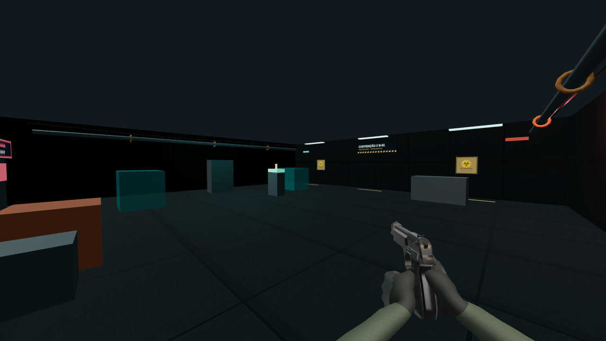
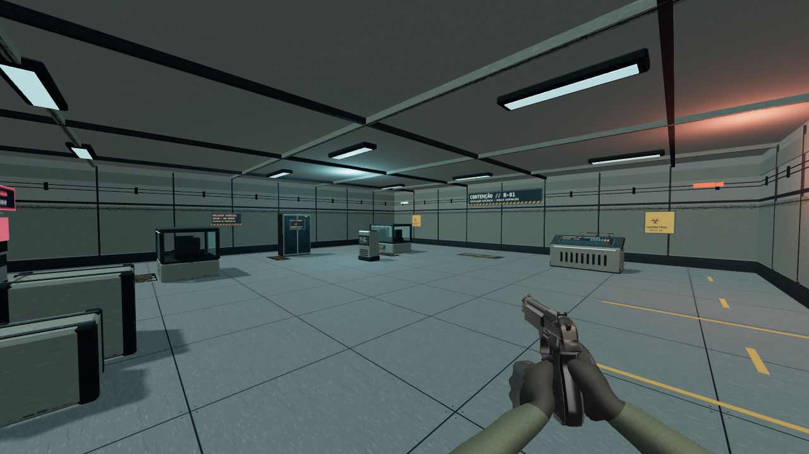

# M8.1.3 — Polish da Sala de Contenção

## Base e escopo

Data: 09/11/2026. Chromium 156.0.8078.79 (Debian 13). Branch: `m8.1.3-environment-polish`.
Base GitHub verificada: `bd7ecbccba272c30af2527ed6cb8dce71c1a7f23` (M8.1.2).
A `main` permanece `12afa63`; os PRs #6 → #7 → #8 preservam as etapas anteriores
em revisão. Esta entrega deve seguir a mesma cadeia, com base no M8.1.2,
sem sobrescrever a main ou descartar commits.

Commits desta etapa:

- `5fb674a`: auditoria, plano e câmeras/workloads repetíveis do cenário anterior.
- `94f9216`: materiais, arquitetura, equipamentos e fechamento superior.
- `3c15a35`: 11 testes novos de integração e segurança do cenário.
- `15df5ca`: retarget visual limitado e um teste adicional do esqueleto real.
- `a8ea03e`: harnesses de compras/passagem e consumo de input no navegador.
- Commit posterior de entrega: evidências e este relatório.

Nenhuma arma, variante, recompensa, custo, perk, missão ou setor novo. Layout,
25 sólidos originais, spawns e interações preservados. Há **uma adição física
explícita**: teto da sala principal, face inferior em Y=3,5 m, usando o tipo
`ceiling` já existente. Evita saltar através do novo forro ao subir nos props.
O salto no piso continua abaixo do teto; os testes Rapier verificam ambos os
casos. Navegação 2D já ignora sólidos elevados; seu algoritmo não foi alterado.

## Auditoria e melhorias observadas

Antes: sala aberta na parte superior, paredes quase pretas, mesma escala de
textura aplicada a blocos de dimensões diferentes, vidro opaco, console e
armário sem peças reconhecíveis. Cada módulo/decoração possuía meshes e
materiais próprios. Uma lâmina de piso em Y=0,016 não correspondia à superfície
física em Y=0.

Depois:

- Piso técnico com juntas, fixações, arranhões e roughness, diretamente no piso
  físico. Removida a lâmina elevada. Faixas mantêm o centro e a porta legíveis.
- Paredes com concreto, painéis de pintura gasta, rodapés, perfis verticais,
  juntas, condutos e abraçadeiras rasas. Forro modular e luminárias suspensas.
- Porta com folhas, vedação, travessas, placa de intertrava e indicadores
  vermelho/ciano comandados pela abertura real. Mesmo collider/compra.
- Console com carcaça chanfrada, painel inclinado legível, tela de falha de
  pressão, grelha e faixa de estado.
- Pods com plinto, armação, equipamento interno e vidro mais transparente.
- Armário elétrico com portas, ventilação, fechos e alerta de rede; caixas com
  protetores de canto, cintas, fechos e identificação biológica.
- Estação M9 e máquinas de perks com carcaças, base, ventilação e interfaces
  preservadas. Placas dos quatro perks, preços e cores continuam visíveis.
- Sinais de quarentena/selagem perdida, manchas localizadas junto aos pods,
  pequenas marcas de impacto e desgaste nas bordas, sem obstáculos novos no piso.
- Luz ambiente fria, ciano e vermelho localizado com contraste moderado. Mais
  leitura dos personagens; sem bloom. Uma sombra direcional de 1024 e duas
  pontuais sem sombra, como antes. Luminárias são emissivas e não nove luzes novas.

Paredes/forro não projetam sombras da luz direcional externa: iluminação
indireta é uma aproximação ambiente/hemisférica. Props e personagens continuam
usando a sombra direcional. Não há GI ou reflexão em tempo real.

## Assets, materiais e arquivos

Arte nova **original, local e procedural**, própria para arquitetura e
maquinário industrial; sem download externo, GLB novo, dependência ou textura
remota. Os modelos da M9, braços e infectados M8.1.2 e suas licenças permanecem
intactos. Não se apresenta uma substituição de personagens nesta tarefa.

Registro/licença de escopo: [environment-m813.json](public/assets/manifests/environment-m813.json)
e [ENVIRONMENT_M813.md](public/assets/manifests/ENVIRONMENT_M813.md).
Os novos pixels e meshes ambientais são CC0-1.0, com texto local; isso não
relicencia assets de terceiros nem o código anterior.

Quatro albedos 512², dois mapas de roughness 512² e um atlas 1024² de placas,
telas e manchas. Metal, pintura, concreto, borracha e vidro têm respostas
separadas. UVs em metros evitam estiramento entre módulos. Atlas com padding
para reduzir sangramento. Estimativa analítica de 13,34 MiB com mipmaps para
as sete texturas RGBA; **não é medição de VRAM**.

348 peças estáticas, agrupadas em 13 batches; cinco batches da porta reutilizam
os materiais. **7.178 triângulos** no cenário/porta novos. Chanfros planos de
44 triângulos substituem a versão inicial de 108 por carcaça. Geometrias,
texturas, materiais e clone de estado da porta são liberados no unmount.
O reinício de sessão reutiliza o cenário; não refaz essas peças por frame.

Arquivos principais alterados/adicionados:

- `src/presentation/rendering/EnvironmentLayout.ts`: assemblies e regiões do atlas.
- `EnvironmentGeometry.ts`: UVs, chanfros e batches estáticos.
- `RoomSurfaces.ts`: texturas locais e materiais compartilhados.
- `ContainmentEnvironment.tsx`: integração e porta vinculada ao Runtime.
- `Scene.tsx`: ambiente e iluminação; bridge de câmera/clock preservado.
- `src/world/maps/containment.ts`: somente novo teto; medidas antigas preservadas.
- `src/tests/M813Environment.test.ts` e snapshot `fixtures/m812-map-solids.json`.
- `HeadRetarget.ts` e `M813HeadTransition.test.ts`: convergência visual durante
  crossfade, sem alterar o gameplay.
- `tools/browser-fixtures/environmentViews.ts`, `visuals.tsx`, `perks.tsx`:
  câmeras e observação exclusivas das fixtures, fora do bundle normal.
- `tools/validate-m813-environment.cjs`, `validate-m813-interactions.cjs` e
  barreiras de consumo de disparo nos harnesses M7.1/M8.1/M8.1.2.
- `package*.json`, `index.html`, `Diagnostics.ts`: versão 0.9.4/M8.1.3.

## Testes executados

Comandos reais, sem omitir a instalação:

```sh
npm ci --cache /tmp/m813-npm-cache
npm test
npx tsc -b
npm run build
npm run test:motion
node tools/build-visual-fixture.mjs
node tools/build-perk-fixture.mjs
ENV_PHASE=before NODE_PATH=/tmp/protocol-browser/node_modules node tools/validate-m813-environment.cjs
ENV_EVIDENCE_DIR=/tmp/m813-final NODE_PATH=/tmp/protocol-browser/node_modules node tools/validate-m813-environment.cjs
EXPECTED_REPORT_VERSION=M8.1.3 M71_EVIDENCE_DIR=/tmp/m813-production-evidence NODE_PATH=/tmp/protocol-browser/node_modules node tools/validate-m71-browser.cjs
EXPECTED_REPORT_VERSION=M8.1.3 M81_EVIDENCE_DIR=/tmp/m813-perk-evidence NODE_PATH=/tmp/protocol-browser/node_modules node tools/validate-m81-browser.cjs
NODE_PATH=/tmp/protocol-browser/node_modules node tools/validate-m813-interactions.cjs
VISUAL_EVIDENCE_DIR=/tmp/m813-combat-evidence NODE_PATH=/tmp/protocol-browser/node_modules node tools/validate-m812-browser.cjs
```

Vite Preview serviu `dist` em 4173, fixture App em 4174 e fixture gráfica em
4175. A captura `before` ocorreu antes de mudar o renderer, não foi reconstruída
com o código novo. As três saídas são builds estáticos Vite, não servidor dev.

| Verificação | Resultado final |
|---|---|
| Instalação limpa | 124 pacotes, exit 0 |
| Vitest | **174 aprovados, 0 reprovados, 26 arquivos** |
| Novos testes M8.1.3 | **12 aprovados, 0 reprovados** (incluídos nos 174) |
| TypeScript `npx tsc -b` | exit 0 |
| Build produção | exit 0; aviso de chunk >500 kB preexistente |
| `test:motion` | **13 aprovados, 0 reprovados** |
| Chromium | Ver resultados/evidências abaixo |

A suíte completa inclui Rapier real, cápsula, parede/porta/deslizamento,
integridade de munição, hitscan/headshots, IA com 1/3/6/12/20 inimigos, perks,
pausa/reinício e progressão R1–10/R1–15 com disparos, recargas e recursos finitos.
Os testes legados que eliminam diretamente pela API não são a evidência de
combate real; os testes de recursos e o navegador exercitam os controladores.

Os 12 testes novos verificam: snapshot dos sólidos anteriores, envelopes das
peças, visibilidade da tela do console, carcaças que não encobrem painéis,
linhas de tiro antes livres, orçamento/disposal das geometrias, atlas sem
sobreposição, rotas/spawns/compras, salto no piso, salto do pod contra o teto,
e transações reais em todas as aproximações. O teste adicional carrega o esqueleto
e clips reais do GLB para verificar blends da cabeça do Brutamontes; apenas a
decodificação de imagens é omitida nesse teste Node, permanecendo no Chromium. Posicionamento no último teste
usa acesso ao Rapier **somente no teste**, sem API de teleporte em produção.

## Navegador e evidências

Quatro harnesses interativos, além da comparação do ambiente, executados com
Chromium automatizado. Resultados brutos em [docs/validation/m813](docs/validation/m813).
Nenhum foi uma sessão manual jogada pelo agente.

- **App de produção:** disparo 15→14, recarga 15/89, compra 15/90 e 500→494 CR,
  sem cobrança com reserva cheia. Rodada 1, pausa, reinício, F8/F9 e botão
  BAIXAR ERROS funcionaram; relatório identifica M8.1.3. HUD não encobre créditos.
- **App com orçamento de teste:** caminhada real até as quatro máquinas,
  compras por E nos preços existentes, 15.750→5.750 CR; duplicata sem débito,
  cura/vida 150, recarga ativa preservada (1,5 s) e próxima 1,125 s, velocidade
  ×1,12, dano 18→15,3, pausa, reinício e negativa com 500 CR. HUD sem sobreposição.
- **Porta/munição:** movimento Rapier por teclado até a porta fechada, bloqueio
  da cápsula, E desconta 750 CR somente uma vez, passagem efetiva além de X=9,2,
  reinício fecha a porta. Munição comprada antes da travessia, desconto exato 6 CR.
  A fixture só fornece créditos via recompensas de rodada; sem teleporte.
- **Combate/animações:** dois headshots matam um comum e gastam duas balas;
  recarga retorna a 15/88, sem criar munição. Quatro arquétipos eliminados com
  **9 disparos, 9 hits/headshots, 4 mortes, 6/90 balas e 950 CR finais**. Mira
  foi automatizada; IA, disparo, dano, cooldown e custo são reais, sem API de
  eliminação direta. Captura de combate pausada após o primeiro disparo.
- **Regressão gráfica:** sete estados, LOD, cadáveres acima do piso (~Y=0,004),
  nove combinações de aspecto/FOV e três ciclos de reinício/limpeza. Contadores
  de geometria nos picos 35/37/37 e após limpar 31/31/31; sem crescimento contínuo
  observado nesses ciclos, não prova ausência universal de vazamentos/VRAM.
- **Assets:** zero erros JavaScript graves e zero HTTP ≥400 nos harnesses que
  monitoram rede; texturas e GLBs locais carregados. O smoke de perks registra
  console, com o aviso Rapier já conhecido; os demais também monitoram respostas.

Capturas PNG sem retoque, nas mesmas câmeras 1280×720/FOV 80 para comparação:

| Vista | Antes | Depois |
|---|---|---|
| Área principal | [anterior](docs/evidence/m813/before-wide.png) | [atualizada](docs/evidence/m813/after-wide.png) |
| Olhar do jogador | [anterior](docs/evidence/m813/before-player.png) | [atualizado](docs/evidence/m813/after-player.png) |
| Console | [bloco](docs/evidence/m813/before-console.png) | [painel/tela/ventilação](docs/evidence/m813/after-console.png) |
| Contenção | [bloco de vidro](docs/evidence/m813/before-pods.png) | [pod detalhado](docs/evidence/m813/after-pods.png) |
| Porta | [anterior](docs/evidence/m813/before-door.png) | [folhas/vedação/sinalização](docs/evidence/m813/after-door.png) |

Antes:



Depois:



[Forro e iluminação](docs/evidence/m813/after-ceiling.png) ·
[Máquinas e acessos](docs/evidence/m813/after-perks.png) ·
[20 infectados](docs/evidence/m813/after-infected-twenty.png) ·
[Combate real](docs/evidence/m813/after-multiple-combat.png) ·
[HUD e compra](docs/evidence/m813/after-purchase-hud.png) ·
[Porta aberta](docs/evidence/m813/after-door-passage.png) ·
[ADS](docs/evidence/m813/after-ads.png) · [Recarga](docs/evidence/m813/after-reload.png).

Inspeção das imagens confirma materiais e volumes reconhecíveis, leitura dos
infectados e equipamentos mais detalhados. Não equivale a aprovação artística
humana nem valida conforto/visibilidade durante uma partida manual prolongada.

## Medições de desempenho

Chromium headless, WebGL/SwiftShader por software, 1280×720, DPR 1, mesma câmera
FPS, mesmos modelos e workloads antes/depois. Uma janela de 5 s por carga (26/19/14 frames antes e 17/14/10 depois);
amostras pequenas e sujeitas a compilação de shaders/agendamento. Não medem
GPU desktop nem representam uma sessão manual a 60 FPS.

| Carga | Draw calls antes → depois | Triângulos/frame antes → depois | Geometrias antes → depois | Texturas antes → depois | FPS observado antes → depois |
|---|---:|---:|---:|---:|---:|
| 0 infectados | 54 → 32 | 16.696 → 25.824 | 68 → 36 | 18 → 21 | 5,27 → 3,52 |
| 4 estáticos | 66 → 44 | 45.534 → 54.662 | 72 → 40 | 27 → 30 | 3,87 → 2,85 |
| 20 animados | 108 → 86 | 139.649 → 148.777 | 74 → 42 | 43 → 46 | 2,89 → 2,05 |

`gl.info` agrega a cena, viewmodel e passes de sombra; os valores por frame
não são somente a quantidade de triângulos únicos do cenário. As cargas de
4/20 usam atores/poses controlados para comparação, não medição da IA inteira.
IA é coberta pela suíte e combate real separado. Redução de 22 calls por carga
(40,7% na sala vazia), 32 geometrias a menos e três texturas a mais.

**Há regressão de frame time no software**, apesar de menos calls: forro antes
ausente preenche mais pixels e os novos materiais/props têm custo adicional.
Não foi disfarçada por reduzir resolução, qualidade dos personagens, IA ou
hitboxes. Uma primeira implementação tinha 12.682 triângulos e sombras no
revestimento inteiro; foi reduzida para 7.178 e sombras somente nos elementos
necessários. Essa otimização reduz geometria/passes, mas não comprova 60 FPS.

[Resumo numérico](docs/validation/m813/performance-summary.json) e resultados
JSON brutos preservam deltas por frame, render.info e contadores
de recursos. Sem `/dev/dri`/GPU nativa disponível: **homologação de desempenho
pendente**, especialmente com 20 infectados. Próximo profiling deve medir GPU
em desktop, fill rate do forro/piso, shaders PBR e passes de sombra. O batching
por superfície sacrifica culling fino; revisar particionamento sala/corredor
se GPU real indicar gargalo. Não adicionar luzes/sombras antes dessa medição.

## Problemas encontrados e corrigidos

1. Albedo antigo multiplicado por cores escuras, UVs esticados e sala sem teto:
   materiais claros controlados, UVs por metro, módulos de revestimento e teto.
2. Ausência de collider no fechamento superior: novo sólido Rapier; testes
   confirmam teto funcional e preservação do salto normal/rotas.
3. Piso visual acima do físico: overlay removido; superfície usa Y=0.
4. Protótipo inicial da tela do console atravessava/olhava para o lado errado
   do painel inclinado. Corrigidos plano, normal e posição; teste por raycast
   exige que a tela seja a primeira superfície vista na aproximação.
5. Carcaças opacas escondiam folhas da porta e faces dos equipamentos. Ajustado
   núcleo/folgas, verificado por screenshots e raycasts de oclusão.
6. Peça da máquina de perks excedia envelope em milímetros: reposicionada.
   Teste de todos os assemblies impede regressão em rotas/spawns.
7. Geometria/sombra da primeira versão custavam demais: chanfro de 44 tris,
   materiais compartilhados, batches separados por necessidade de sombra.
8. Cliques muito breves de testes podiam começar/terminar entre frames no
   renderizador lento. Harnesses agora aguardam o disparo consumido antes de
   soltar o botão; nenhuma mudança na cadência ou input de produção.
9. Um teste legado de 20 infectados excedeu 5 s enquanto Vitest e Chromium
   disputavam CPU. Nova execução isolada passou; não relaxamos asserts/timeout.
10. Transição de ataque do Brutamontes deixou a cabeça visual a 0,23657 m do
    alvo, excedendo a margem de teste 0,235 m (hitbox real continua 0,25 m).
    Uma terceira passagem CCD limitada no renderer corrige a convergência:
    repetição aprovada, tolerância mantida, sem mudar IA, duração ou dano.
    Preservado JSON da falha original e criada cobertura do esqueleto real.
11. No ensaio de compras, o orçamento de fixture para 40 rodadas era 56 CR
    menor que quatro perks+porta+munição. Fixture usa 50 recompensas, como o
    ensaio M8.1. Não houve alteração da economia para fazer o teste passar.

## Limitações e recomendação

- Pendente GPU desktop/60 FPS e revisão humana em movimento. Capturas foram
  inspecionadas; não houve sessão de FPS jogada manualmente.
- Somente a sala principal ganhou teto; o corredor já existente recebeu
  materiais/revestimentos, mas ainda não tem fechamento superior. Não foi
  expandido ou transformado em outro setor.
- Materiais e props são arte procedural industrial, sem scans, normal maps,
  GI, AO offline ou reflexos reais; textura pode repetir em superfícies grandes.
- A luminária direcional é uma aproximação de iluminação interna. Vidro dos
  pods permanece uma barreira física opaca para hitscan, como o sólido anterior;
  sua nova transparência visual não concede tiro através dele.
- Aviso de inicialização Rapier deprecada e tamanho do chunk Vite preexistem.
  Nenhum dano/HP, recompensa ou duração de arma foi alterado para esta entrega.
- Estado de revisão hospedada/GitHub registrado no final após envio.

**Recomendação:** revisar e integrar esta melhoria visual pela cadeia de PRs,
com aprovação de desempenho condicionada ao profiling em GPU compatível. A
próxima etapa deve ser revisão artística/otimização do cenário existente;
não iniciar novos mapas, setores ou M8.2 automaticamente.
