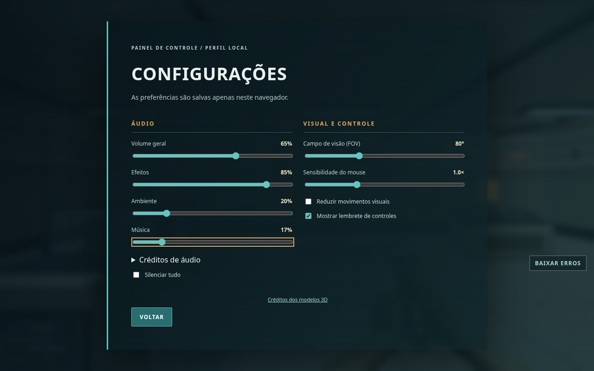

# M8.1.4-A — Horror Audio System

## Base auditada e integração

Branch: `m8.1.4a-horror-audio`. Base `desktop-windows-test-build` / `f66f746` (PR #11), contendo M8.1.4 `a048fb4` (PR #10). Código de áudio: commits `b275813`, `1af7585`, `8ec4ae0`. A main remota permaneceu em `12afa634`; as versões visuais/desktop estão disponíveis em branches/PRs, ainda separadas da main.

[PR #12](https://github.com/mestre-pogramador-ai/PROTOCOLDEADZONE/pull/12) depende da sequência #6 → #7 → #8 → #9 → #10 → #11. Não houve merge, rebase ou sobrescrita dessas branches. Não foram criados setores, armas ou comportamentos de gameplay.

O AudioDirector anterior produzia bipes/osciladores para 13 cues e dois drones contínuos, sem vozes de infectados, materiais de impacto ou sincronização de pausa. Os eventos reais de disparo, dano, eliminação, recarga, economia, rodada e Game Over já existiam. Foram preservados o serviço, seu construtor e os métodos unlock/setSettings/dispose, substituindo a reprodução provisória por buffers locais.

## Arquivos e funcionalidades

- `AudioDirector.ts`: mixer Web Audio com buffers compartilhados, compressor no master, grupos effects/enemy/music/ambient e descarte explícito de fontes, panners, ganhos e contexto.
- `AudioCatalog.ts`: 33 arquivos, regras de intensidade musical e limites de vozes.
- `Runtime.ts` / `EventBus.ts`: metadados opcionais de impacto e posição no evento de disparo; eventos de gatilho vazio e abertura confirmada da porta. Hitscan, dano, cadência, munição, créditos, física, IA e arquitetura do GameClock não foram alterados.
- `Settings.ts` / `App.tsx`: música com volume independente, persistência compatível com configurações antigas (padrão 30%) e créditos de áudio visíveis no painel. O polling existente de 100 ms alimenta o observador de áudio com snapshots; não há um segundo loop de física.
- `tools/prepare-audio.py`: receita reproduzível (Python, numpy, py7zr e FFmpeg), downloads com URLs verificadas e mirror Kenney fixado por commit. Os caminhos /tmp são caches reconstruíveis, não dependências de execução.
- `tools/browser-fixtures/audio.*`, `build-audio-fixture.mjs`, `validate-audio.cjs` e `validate-audio-app.cjs`: testes de integração e produção. A fixture não entra no build normal do jogo.
- `tools/desktop-smoke.cjs`: exige `audio.ready` com 33 carregados/0 falhas no relatório exportado pelo EXE.

A M9 usa um sample de pistola com cinco pequenas variações de playback rate, Foley de ferrolho, retirada/inserção do carregador, final de recarga e gatilho vazio. Inserção ocorre após 70% da duração real da recarga observada; o término vem do evento confirmado do controlador. Mãos Rápidas mantém sua duração latched; nenhum som concede munição. Impactos seguem o primeiro hit confirmado e o material do collider existente (metal, concreto, vidro ou inimigo); headshot e eliminação dependem dos eventos de combate.

## Assets locais, origem e licença

Existem **33 WAVs locais**, total **3,768,880 bytes**, em `public/assets/audio/`. Cada arquivo tem origem, autor, licença, transformação, tamanho e SHA-256 em [manifest.json](public/assets/audio/manifest.json). Os formatos de terceiros foram convertidos para mono PCM de 44,1 kHz, adequado à espacialização; as camadas DSP originais usam 22,05 kHz. Não há streaming/CDN durante a partida.

| Arquivos | Origem e autoria | Licença / tratamento |
| --- | --- | --- |
| m9-shot.wav | [Michel Baradari / apollo-music.de](https://opengameart.org/content/chaingun-pistol-rifle-shotgun-shots), shots.7z / pistol.wav | CC-BY 3.0; mono, limiter e variações de pitch na reprodução. Crédito na interface e distribuição. É pistola genérica, não gravação certificada de Beretta M9. |
| infected-1…8.wav | [artisticdude](https://opengameart.org/content/zombies-sound-pack), zombies.zip / zombie-1…8.wav | CC0; conversão mono PCM. |
| slide, magazine, step-1, step-2, door, cloth | Kenney RPG Audio, [mirror fixado Boyquotes](https://github.com/Boyquotes/kenney-rpg-audio-for-godot) | CC0; nomes originais e URLs completas fixadas no manifest. Foley adaptado, não gravações próprias da M9. |
| glass, concrete, metal | [rubberduck](https://opengameart.org/content/75-cc0-breaking-falling-hit-sfx) | CC0; glass_hit_01, rock_hit_01 e metal_hit_01. Rocha aproxima concreto. Vidro usa impacto, sem comunicar destruição dos pods. |
| menu, preparation, suspense, combat, critical, gameover, vent, electric, flesh, alarm, click, headshot, kill, denied, purchase | DSP original produzido por tools/prepare-audio.py para o projeto | CC0 na medida aplicável. São designs sintetizados em arquivos WAV; não gravações de campo, carne ou mecanismos reais. |

Fontes/licenças também em [SOURCES.md](public/assets/audio/licenses/SOURCES.md), SHOT-CREDIT.txt e KENNEY-CC0.txt. A licença CC-BY 3.0 e as modificações são identificadas no painel de áudio. Nenhuma música comercial ou áudio extraído de jogos foi utilizado.

O site Kenney respondeu 403 no primeiro acesso; foi usado um mirror com licença CC0 verificada e commit fixado. Os assets OpenGameArt foram efetivamente baixados e convertidos, não apenas referenciados por links.

## Infectados e ambiente

Arquétipos existentes: Comum, Corredor, Brutamontes e Predador. Bancos distintos (1/2, 3/4, 5/6, 7/8), rates base .88 / 1.13 / .65 / 1.28, variações pequenas e cadências diferentes distinguem as vozes. Hurt/death usam tratamento de rate próprio; não há novos comportamentos de IA.

Idle/perseguição vocalizam com intervalos e início escalonado por ID. Windup, golpe, reação e morte são observados nos estados reais; passos acompanham walkPhase e exigem deslocamento. O golpe vocal/Foley não aplica dano: o feedback de dano só toca no evento confirmado. A semântica dos takes (respiração, gemido, ataque/morte) ainda precisa de direção e avaliação auditiva; não foram gravados bancos exclusivos para cada ação/arquetipo.

PannerNode HRTF, distância inversa, referência 2 m, rolloff 1.3 e maxDistance 30 m. Fontes seguem os infectados; listener segue posição, yaw e pitch do operador. Limites: **32 fontes totais**, **10 de infectados**, até duas por infectado e reserva para efeitos importantes. Vocalizações distantes são evitadas, com espaçamento para impedir coro simultâneo de 20 takes iguais. Eventos podem ser descartados para respeitar o orçamento. Os emissores começam na posição correta, e só o acompanhamento posterior usa suavização.

Ventilação e zumbido elétrico são camadas originais posicionadas na sala; alarmes distantes e estalos metálicos são pontuais e espaçados. A porta usa Foley local no evento de compra/abertura. Não foram alterados props, colliders, spawns ou navegação. Sem oclusão acústica por raycast ou reverberação geométrica nesta entrega.

## Música dinâmica e ciclo de vida

| Estado | Condição |
| --- | --- |
| Menu | Após interação com configurações, antes da partida; autoplay respeitado |
| Preparação/exploração | Preparação da rodada ou ameaça distante |
| Suspense | Inimigo a menos de 15 m durante rodada ativa |
| Combate | Inimigo a menos de 5 m |
| Vida crítica | HP ≤25, com prioridade sobre exploração/combate |
| Game Over | Evento confirmado de fim de sessão |

Seis camadas originais de oito segundos, crossfades de até três segundos, proteção contra alternância rápida, volume musical independente e janelas de silêncio em preparação/suspense (20 s a cada ciclo de 80 s do contexto). Combate e vida crítica não são silenciados por essas janelas. Não se trata de trilha orquestral licenciada pronta; é composição DSP original para avaliação.

Pausa normal suspende o AudioContext, congelando envelopes/fontes. Retomada segue o evento da sessão. Game Over mantém a trilha final e encerra vozes de infectados em vez de suspendê-la pelo evento de pausa subsequente. Reinício para as fontes antigas e reutiliza buffers/contexto; dispose aborta carregamentos, cancela fontes, desconecta nós e fecha o contexto. Cues antes de unlock/carregamento são ignorados, sem bloquear gameplay. Falhas registram audio.asset.failed nos diagnósticos; sucesso registra audio.ready.

## Verificações executadas

| Comando/cenário | Resultado |
| --- | --- |
| npm ci | Concluído |
| npm test | 192 aprovados, 0 reprovados, 30 arquivos, incluindo regressões Rapier/combate/IA/economia/perks/rodadas |
| npx tsc -b | Aprovado |
| npm run build | Aprovado, incluindo assets locais; aviso existente de bundle >500 kB permanece |
| npm run test:motion | 13 verificações aprovadas |
| npm run desktop:pack | Aprovado; pacote Linux com 33 WAVs no ASAR e todos os hashes correspondentes ao manifest |
| Fixture compilada com Vite de produção + Chromium nativo Web Audio | Aprovada; 33 samples decodificados, 0 falhas de asset/console, um único contexto reutilizado e depois closed |
| Interface React de produção via Vite Preview + Chromium | Aprovada; música alterada para 17%, persistência após reload, exportação com audio.ready=33 e 0 erros |
| CI Windows / EXE | [Execução 44024490575 aprovada](https://github.com/mestre-pogramador-ai/PROTOCOLDEADZONE/actions/runs/44024490575), commit 8ec4ae0: todos os comandos, Portable/NSIS e smoke aprovados; audio.ready com loaded=33 / failed=0 |

### O que o navegador realmente exercitou

A fixture usa o **Runtime real** para tiros, consumo de munição, recarga e eliminação de um infectado com 100 HP por quatro tiros corporais. Não elimina o inimigo por API nem emite um kill falso. O teste de Game Over musical emite o evento de sessão diretamente; não simula uma partida até a morte física. Os demais estados musicais, estresse de 20 vozes e posições são **snapshots controlados** fornecidos ao observador de áudio; não representam 20 inimigos sendo jogados manualmente no FPS.

Verificou arma vazia, remoção/inserção do carregador, volume/mute real do master, preparação/combate/suspense/crítico/Game Over, pausa/retomada e reinício sem novo download dos 33 samples. O burst de 20 windups atingiu exatamente **10 vozes de infectados**; o pico total observado foi **14**. Esses são contadores de fontes, não FPS nem medição de qualidade sonora. O teste confirma que novos panners são inicializados na origem do emissor e que o AudioContext nativo termina em closed após dispose.

Na interface principal, a página é recarregada para testar persistência, criando outro contexto normalmente. Isso é diferente do reset de sessão, que reutiliza o contexto e buffers. Requests da segunda navegação podem aparecer nas evidências. O teste usa SwiftShader apenas no Chromium de nuvem para abrir a interface WebGL; nenhuma flag de desativação de GPU foi adicionada ao jogo ou Electron. A fixture de áudio não precisa renderizar uma cena 3D.

Evidências em `docs/validation/audio/`: logs de instalação/testes/build, chromium-runtime-audio.json, chromium-production-app.json e captura settings.png. As fixtures/scripts são reproduzíveis com node tools/build-audio-fixture.mjs, Vite Preview do diretório /tmp/pdz-audio-browser na porta 4186 e node tools/validate-audio.cjs. A verificação da interface usa o dist de produção na porta 4187 e node tools/validate-audio-app.cjs.

### Evidência Windows e download

[Baixar Portable e instalador desta versão de áudio](https://github.com/mestre-pogramador-ai/PROTOCOLDEADZONE/actions/runs/44024490575/artifacts/14302423839) (GitHub login necessário). [Artifact de evidências](https://github.com/mestre-pogramador-ai/PROTOCOLDEADZONE/actions/runs/44024490575/artifacts/14302478581).

O smoke executou o app empacotado `win-unpacked/PROTOCOL-DEAD-ZONE.exe`, com assets locais via pdz://game, exportou o JSON com audio.ready (33/0), não capturou erros de console/JavaScript/HTTP ≥400 e terminou na etapa passed/saída 0. Ambiente: Windows Server 2025, Microsoft Basic Render Driver/D3D11 (software). Sem validação em GPU física, sem aprovação auditiva e sem instalação/desinstalação manual no Windows 10/11; wrappers Portable/NSIS foram gerados, não jogados manualmente. Pacotes continuam sem assinatura digital.

Os logs resumidos e JSONs reais estão em windows-validation.log, windows-diagnostics.json e windows-result.json no diretório de evidências. O commit posterior apenas acrescenta esta documentação, preservando o código validado. O check externo Vercel informa Deployment was blocked; ele não é o workflow desktop. Permissões de hospedagem não foram alteradas.

## Problemas encontrados e correções

1. Drones anteriores não acompanhavam pausa: integração com eventos do ciclo de vida e suspensão do contexto.
2. Não havia material de impacto nem gatilho vazio: metadados derivados do trace existente e evento do controlador, sem segundo hitscan ou cobrança.
3. Panner novo podia começar no centro enquanto suavizava a posição: inicialização imediata, acompanhamento suavizado; teste nativo acrescentado.
4. Teste inicial esperava kill com dois tiros de 32 em 100 HP: corrigido para quatro, mantendo balanceamento original.
5. Favicon ausente da fixture provocava 404: fixture aponta ao favicon local existente. Execuções finais sem 404.
6. Leitura tardia do pico de vozes perdia sons curtos: captura síncrona após o burst, mais amostragem de dois segundos; limites não foram aumentados.
7. Material de vidro passou a usar glass_hit, evitando som de destruição para pods que continuam sólidos. A redução inicial de sample rate dos arquivos externos foi removida para preservar 44,1 kHz.
8. Primeira tentativa Windows do commit b275813 expirou durante clique inicial no runner; a execução seguinte 1af7585 passou. Não foi atribuída falsamente a uma correção de gameplay. A execução final 8ec4ae0 passou sem aumentar limites/timeout nem modificar o gameplay.

## Limitações e revisão pendente

**Não houve aprovação auditiva com fones.** Headless Chromium/contagem de nós não permite avaliar timbre, loudness percebido, repetição, imagem estéreo, sustos, mascaramento de sinais ou fadiga. Falta revisão humana em fones/caixas, diferentes placas de som, Web e Windows 10/11 físico.

A pistola é sample genérico de biblioteca com variações de pitch; Foley é adaptado. Bancos vocais são compartilhados e processados; takes exclusivos de respiração, ataque e morte ainda são uma prioridade de sound design. Música/ambientes e sinais de carne/UI são DSP original, não gravações reais; não estão certificados como áudio profissional final.

O observador trabalha a 10 Hz: estados muito breves sob stalls extremos podem não gerar todos os cues, embora os eventos principais de arma/eliminação continuem confirmados pelo bus. Não foram medidas latência acústica, LUFS ou FPS. Revisar sincronismo perceptivo de recarga/ferrolho com as animações em hardware real. Pause/dispose/reset foram testados tecnicamente; dispositivos USB/Bluetooth e mudança de dispositivo não foram testados manualmente.

Não é recomendável iniciar novos setores para encobrir pendências sonoras. Próxima etapa recomendada: revisão deste PR na ordem das dependências e sessão de escuta/mixagem; nenhuma atualização de gameplay ou cenário foi iniciada automaticamente.
