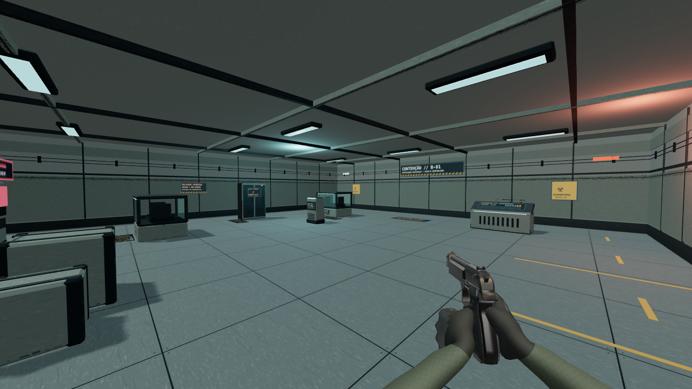

# M8.1.4 — Otimização e validação da Sala de Contenção

Data: 09/11/2026. Branch: `m8.1.4-containment-optimization`.
Base visual mais recente confirmada: `71b6cea0443ad886b921ea39232422287ff0c63b`
(M8.1.3/PR #9). Main verificada em `12afa634bb213ea550c762ba2f7b662ad1a34854`.

**Resultado:** melhoria observada no renderizador por software, preservando
materiais/iluminação/348 peças do cenário e os modelos dos personagens. Todos
os testes finais executados passaram. Não há homologação de 60 FPS em GPU real.
Nenhum novo setor, missão, arma, atributo, preço ou recompensa foi implementado.

## 1. Revisão e commits

Cadeia pendente conferida no GitHub, todos MERGEABLE na leitura inicial:

| PR | Versão | Base |
|---|---|---|
| #6 | M8.1 | main |
| #7 | M8.1.1 | m8.1-perks |
| #8 | M8.1.2 | m8.1.1-visual-overhaul |
| #9 | M8.1.3 | m8.1.2-visual-quality |

O PR #4, relatório antigo do M7, permanece separado dessa cadeia. Não foi
alterado. Não houve merge, force-push ou sobrescrita da main nesta tarefa.
M8.1.4 deve ser revisado sobre #9, respeitando a ordem de integração.
Estado final do novo PR registrado ao fim deste relatório. Na conferência final,
o PR histórico #4 foi identificado como CONFLICTING; não foi mesclado ou
modificado. A cadeia #6–#9 continuava MERGEABLE.

Commits recuperáveis:

- `155b249`: referência repetível, instrumentação e snapshot visual M8.1.3.
- `b2892d0`: albedo/roughness compartilhados e índices nos buffers estáticos.
- `74ee37f`: bounds de animação e culling independente para câmera/sombra.
- `f23bc35`: kit reutilizável, regiões, luzes e testes; versão 0.9.5/M8.1.4.
- `e455c8f`: correção do retarget e teste com windup real do Brutamontes.
- `9b19bbc`: combate real, recursos, diagnóstico de fill e documentação do kit.
- Commit documental posterior: relatório, screenshots, logs e revisão GitHub.

## 2. Alterações implementadas

### Materiais e custo de shading

Mantidos MeshStandardMaterial, Fresnel, iluminação, mapas dos personagens,
vidro, luzes e sombras anteriores. Para piso/pintura, roughness linear passa
do mapa separado para o alfa do mesmo albedo. O shader reaproveita o texel já
lido; RGB continua sRGB. Materiais continuam opacos, sem alpha-test e opacity 1,
com saída alfa opaca. Guards e testes impedem aplicar esse contrato em superfícies
translúcidas. A pequena quantização da operação Canvas foi medida nas capturas.

Texturas ambientais: **7 → 5**; removidas duas texturas 512² independentes,
sem remover sua informação. Estimativa RGBA com mipmaps: 13,33 → 10,67 MiB
(-2,67 MiB). É estimativa analítica, não medição de VRAM.

### Índices, compartilhamento e culling

- Todas as **348 peças e 7.178 triângulos únicos** do cenário/porta preservados.
  Snapshot compara posições, dimensões, superfícies e shadow flags a 1 µm.
- Buffers estáticos indexados por atributos completos (posição/normal/UV),
  tolerância 1e-6 m. Vértices: **21.534 → 14.564**. Arrays de atributos:
  689.088 → 466.048 bytes, mais 43.068 bytes de índices. Total novo 509.116
  bytes, cerca de 26% menor; medição de arrays CPU, não VRAM.
- Batches por região: 13 da sala, 9 do corredor e 5 da porta. Materiais continuam
  compartilhados. Isso permite culling do corredor sem arrastar seus vértices
  em todos os lotes da sala. Aumenta o número de geometrias residentes após
  olhar todas as regiões, mas reduz trabalho submetido fora da câmera.
- Infectados usam esferas locais conservadoras derivadas dos clips reais,
  33 amostras/clip + margem de 0,65 m, SHA-256 do asset e testes em outros
  instantes/escalas/retarget. Câmera e câmera de sombra são avaliadas pelo Three
  separadamente: sair da câmera não desliga a sombra ou a IA/animação.
- LOD, texturas, materiais, número de polígonos e atualização dos personagens
  permanecem existentes. Bounds desconhecidos/incompatíveis mantêm culling
  desativado, prevenindo desaparecimento de assets futuros.

### Kit para reutilização

Extraídos piso, parede, teto, moldura/porta, luminária, conduto, painel e props
industriais, com posição/dimensões/yaw. O adaptador da Sala de Contenção ainda
escolhe posições e storytelling; o kit não importa Runtime, mapa, economia ou
física. Tema de placas e rig de luzes parametrizáveis, com os mesmos defaults.

[Documentação do kit](docs/ENVIRONMENT_MODULE_KIT.md) ·
[Inventário M8.1.4](public/assets/manifests/environment-m814.json) ·
[Bounds dos personagens](public/assets/manifests/character-bounds-m814.json).
Não há outro cenário instanciado; exemplos de API/testes não são novos setores.

Arquivos principais: `EnvironmentGeometry.ts`/`ContainmentEnvironment.tsx`
(buffers/regiões), `RoomSurfaces.ts`/`EnvironmentShaders.ts` (mapas),
`EnvironmentModuleKit.ts`/`EnvironmentTypes.ts`/`EnvironmentLights.tsx`/
`EnvironmentLayout.ts`/`Scene.tsx` (kit/adaptador), `CharacterCulling.ts`/
`InfectedView.tsx`/manifest de bounds (visibilidade), `HeadRetarget.ts` e
`M813HeadTransition.test.ts` (correção de margem), novos testes M814 e ferramentas
listadas abaixo. `package*.json`, `index.html` e `Diagnostics.ts` identificam
0.9.5/M8.1.4. Nenhum arquivo de mapa físico, economia ou IA foi modificado.

## 3. Investigação do gargalo

Referência fresca do M8.1.3 na mesma sessão, sem reutilizar os números antigos
do relatório anterior. Chromium **156.0.8078.79**, ANGLE/Vulkan **SwiftShader**,
1280×720, DPR 1, FOV 80, mesmos modelos/posições e cargas 0/6/12/20. Sequência
ascendente e descendente, duas amostras de 24 frames/carga, cada uma após oito
frames de aquecimento. Sem Vitest/builds concorrentes nas medições.

Essas cargas controlam pose/perseguição visual e mantêm os atores parados para
comparação; não simulam a IA inteira. Combate real é medido separadamente.
FPS = 1000/média dos deltas, não média de FPS instantâneos. Os 48 frames por
carga são amostras pequenas em máquina compartilhada, com outliers.

### Antes/depois final — mesmo protocolo

| Infectados | FPS antes → depois | Frame mediano ms | p95 ms | Calls | Triângulos/frame | Geometrias | Texturas |
|---:|---:|---:|---:|---:|---:|---:|---:|
| 0 | 3,13 → 3,69 | 310,75 → 272,90 | 494,80 → 538,20 | 32 → 32 | 25.824 → 24.402 | 36 → 45 | 21 → 19 |
| 6 | 2,82 → 3,10 | 356,65 → 315,45 | 688,80 → 369,20 | 48 → 48 | 68.958 → 67.536 | 42 → 51 | 32 → 30 |
| 12 | 2,38 → 2,67 | 414,75 → 377,45 | 781,30 → 435,50 | 68 → 68 | 112.338 → 110.916 | 42 → 51 | 38 → 36 |
| 20 | 2,13 → 2,36 | 467,45 → 412,25 | 870,90 → 557,70 | 86 → 86 | 148.777 → 147.355 | 42 → 51 | 46 → 44 |

Ganho médio observado de FPS: cerca de 18%/10%/12%/11%, respectivamente.
Não implica o mesmo ganho em GPU real nem ausência de stutter: o p95 da sala
vazia piorou nessa amostra. A redução de 1.422 triângulos submetidos/frame vem
do descarte de região, não de eliminar detalhes. `gl.info` agrega mundo,
viewmodel e passes de sombra; triângulos/frame não são triângulos únicos.

A submissão CPU de `gl.render` ficou na ordem de 0,7–2,7 ms antes e 0,8–2,5 ms
depois (medianas por carga), muito abaixo do intervalo entre frames no software.
Isso não é tempo de GPU: chamadas WebGL/compositor/backend são assíncronos.

### Teto/piso, PBR e preenchimento — somente diagnóstico

| Vista | Resolução | PBR FPS / mediana ms | Unlit diagnóstico FPS / mediana ms |
|---|---|---|---|
| Teto | 1280×720 | 3,91 / 242,90 | 5,39 / 183,85 |
| Teto | 640×360 | 10,14 / 98,55 | 13,13 / 78,05 |
| Piso | 1280×720 | 3,34 / 289,25 | 5,53 / 171,65 |
| Piso | 640×360 | 11,63 / 85,70 | 15,37 / 64,50 |

16 frames/ensaio, oito de aquecimento, câmera pausada. Na vista do teto,
41 calls/25.362 triângulos; piso, 32/24.402, iguais nas duas resoluções.
Sombra continua 1024. O ganho com ¼ dos pixels, sem mudar chamadas/geometria,
é compatível com custo significativo de preenchimento/shading no SwiftShader.
O modo unlit delimita o custo da iluminação da cena; não isola somente um
material, nem mede um estágio de GPU real. **Essas reduções de resolução e de
shading não foram aplicadas ao jogo.** As capturas e o benchmark final mantêm
1280×720/PBR.

Ensaios da referência na vista FPS, medianas:

- Normal: 301,8 ms; sem sombra: 306,7 ms.
- Sem mapa separado de roughness: 306,9 ms; sem vidro: 326,6 ms.
- Unlit: 188,8 ms; nova referência normal: 286,9 ms.

Sombras/vidro não mostraram vantagem ao serem retirados nessa amostra; foram
preservados. Um protótipo de redução algébrica GGX para roughness=1 produziu
A/B inconclusivo (normal especializado 3,66 e 4,02 FPS; genérico 3,82). Foi
**removido**, evitando um patch no BRDF completo. O hook compacto de amostragem de roughness
permanece e deve ser revalidado ao atualizar Three.
O empacotamento de roughness foi mantido pelo compartilhamento de recursos.

### Descarte fora da câmera

Mesmo build final, 20 atores/mesma pose pausada atrás da câmera, somente
alternando o frustum culling dos SkinnedMesh:

- Comportamento anterior, culling desligado: 94 calls, 147.411 triângulos.
- Culling ligado: 64 calls, 82.134 triângulos; FPS observado 3,51 → 4,14.
- **Diferença entre screenshots: zero.** Sombras continuam sendo processadas
  pelo frustum da luz; materiais e animações não foram reduzidos.

Dados brutos: [before-profile.json](docs/validation/m814/before-profile.json),
[after-profile.json](docs/validation/m814/after-profile.json),
[fill-diagnostics.json](docs/validation/m814/fill-diagnostics.json) e
[summary.json](docs/validation/m814/summary.json).

## 4. Combate real e validação funcional

### Amostras com IA real

A fixture posiciona 6/12/20 infectados em lugares válidos, HP-base
100/70/180/120 e todos os quatro arquétipos. Scheduler de rodadas desativado
para manter a carga inicial; IA, colisões, ataque/dano, M9, hitscan, créditos e
munição reais. Mira automatizada. Sem invulnerabilidade, eliminação direta,
setter de dano ou munição gratuita. Não é uma progressão R1–10 nem partida manual.

| Carga inicial | Frames | FPS | Mediana / p95 ms | Disparos / hits / mortes | HP final | Munição | Calls / triângulos finais |
|---:|---:|---:|---:|---:|---:|---:|---:|
| 6 | 67 | 2,64 | 271,60 / 1.156,50 | 9 / 9 / 4 | 60 | 6/90 | 65 / 68.858 |
| 12 | 68 | 2,18 | 440,50 / 1.441,10 | 9 / 9 / 4 | 56 | 6/90 | 87 / 108.680 |
| 20 | 68 | 1,89 | 443,25 / 1.644,10 | 9 / 9 / 4 | 64 | 6/90 | 108 / 158.863 |

Todos os hits foram headshots; saldo final 950 CR. As amostras incluem
transições/efeitos/input automatizado e outliers. Não são comparação A/B:
câmera e inimigos se movem, e a carga diminui com as mortes. Não misturar seus
FPS com a tabela controlada de renderização. Recursos finais por carga:
44/26, 47/34 e 50/42 geometrias/texturas.

### Chromium e regressões

- Produção: início, HUD, disparo 15→14, recarga 15/89, compra 15/90 e
  500→494 CR; reserva cheia sem débito, rodada 1, pausa, reinício, F8/F9 e botão
  **BAIXAR ERROS**. Exportação identifica M8.1.4. Créditos/HUD sem sobreposição.
- Perks: caminhada por teclado até as quatro máquinas, E, preços e efeitos,
  compra duplicada sem custo, cura/maxHP 150, recarga atual 1,5 s preservada e
  próxima 1,125 s; velocidade ×1,12, dano 18→15,3, pausa/reinício e saldo
  insuficiente. Fixture fornece 15.250 CR em recompensas para esse ensaio.
- Porta: aproximação com cápsula Rapier, bloqueio fechado, compra de 750 CR
  uma única vez, passagem além de X=9,2, reset fecha a porta. Munição adquirida
  antes por 6 CR, sem teleporte no navegador.
- Suite gráfica/combate: sete estados, LOD, nove combinações de aspecto/FOV,
  ADS, recarga, dois headshots/uma morte, 4 arquétipos eliminados com 9 disparos,
  6/90 balas, mortes/removal e três resets. Tolerâncias de mira/cabeça mantidas.
- Zero erros graves de console nas execuções finais e zero HTTP ≥400 nas que
  monitoram rede. O harness de perks registra console, não coleta HTTP.
  Aviso Rapier de inicialização deprecada permanece conhecido.

### Recursos após reinícios

O teste dedicado aguarda o cache aposentar os modelos dos infectados e confirma
apenas os dois assets de viewmodel ainda referenciados, antes de comparar:

| Ciclo | Geometrias/texturas carregadas | Após limpar e aguardar aposentadoria |
|---:|---:|---:|
| 1 | 34 / 40 | 28 / 15 |
| 2 | 34 / 40 | 28 / 15 |
| 3 | 34 / 40 | 28 / 15 |

Sem crescimento contínuo observado. O ensaio gráfico antigo também passou;
suas leituras antes de o cache terminar podem conter recursos ainda retidos.
Os números dependem das vistas já desenhadas: o benchmark olha todas as regiões,
enquanto este teste usa a câmera de reinício. `gl.info` conta recursos enviados
ao renderer; não equivale a VRAM/heap nem prova ausência universal de vazamento.

## 5. Testes e comandos executados

| Verificação final | Resultado |
|---|---|
| `npm ci --cache /tmp/m814-npm-cache` | 124 pacotes; exit 0 |
| `npm test` | **184 aprovados, 0 reprovados, 28 arquivos** |
| Testes novos M8.1.4 | **10 aprovados**, incluídos nos 184 |
| `npx tsc -b` | exit 0 |
| `npm run build` | exit 0; aviso de chunk >500 kB preexistente |
| `npm run test:motion` | **13 aprovados, 0 reprovados** |
| Chromium final | Render, compras, combate, recursos e diagnósticos aprovados |

A suíte inclui Rapier real, colisões/paredes/teto/porta, navegação/spawns,
separação de infectados, salto/câmera, munição, perks, créditos, pausa/reset e
progressão com recursos finitos até R10/R15. Os testes antigos com eliminação
por API não são a evidência de combate real apresentada acima.

Ferramentas adicionais realmente executadas:

```sh
node tools/measure-m814-culling.mjs
node tools/inventory-m814-batches.mjs
node tools/build-visual-fixture.mjs
node tools/build-perk-fixture.mjs
NODE_PATH=/tmp/protocol-browser/node_modules node tools/probe-native-webgl.cjs
PROFILE_PHASE=before PROFILE_ABLATIONS=1 NODE_PATH=/tmp/protocol-browser/node_modules node tools/profile-m814.cjs
PROFILE_PHASE=after PROFILE_CULLING=1 NODE_PATH=/tmp/protocol-browser/node_modules node tools/profile-m814.cjs
NODE_PATH=/tmp/protocol-browser/node_modules node tools/diagnose-m814-fill.cjs
EXPECTED_REPORT_VERSION=M8.1.4 M71_EVIDENCE_DIR=/tmp/m814-production NODE_PATH=/tmp/protocol-browser/node_modules node tools/validate-m71-browser.cjs
EXPECTED_REPORT_VERSION=M8.1.4 M81_EVIDENCE_DIR=/tmp/m814-perks NODE_PATH=/tmp/protocol-browser/node_modules node tools/validate-m81-browser.cjs
M813_INTERACTION_DIR=/tmp/m814-interactions NODE_PATH=/tmp/protocol-browser/node_modules node tools/validate-m813-interactions.cjs
VISUAL_EVIDENCE_DIR=/tmp/m814-combat NODE_PATH=/tmp/protocol-browser/node_modules node tools/validate-m812-browser.cjs
NODE_PATH=/tmp/protocol-browser/node_modules node tools/validate-m814-real-combat.cjs
NODE_PATH=/tmp/protocol-browser/node_modules node tools/validate-m814-resources.cjs
```

Vite Preview: build normal em 4173, fixture App em 4174, fixture gráfica em
4175. Fixtures são builds separados, não expõem suas APIs no bundle normal.
Logs, arrays de frames, diagnósticos F8/F9 e checksums estão em
[docs/validation/m814](docs/validation/m814).

## 6. Problemas encontrados e corrigidos

1. Vértices não indexados e batches globais: índices e partição sala/corredor,
   sem remover peças ou triângulos únicos.
2. Dois mapas separados por superfície de piso/pintura: albedo+roughness no
   mesmo texel opaco, com testes de contrato e comparação gráfica.
3. SkinnedMesh com culling sempre desligado: envelopes locais de todos os clips,
   margem, hash e validação com o mesmo skeleton compartilhado do renderer.
4. O ensaio do Brutamontes reproduziu cabeça a **0,243872 m** do alvo. O teste
   anterior usava windup 0,45 s do Comum; agora usa **0,8 s real** e reproduziu
   exatamente o erro em Node. CCD permanece limitado a 0,24 rad/correção e alvo
   0,20 m, com até seis passagens e saída antecipada. A margem do teste 0,235 m,
   hitbox, dano e duração de IA não mudaram. Repetição Node/Chromium aprovada;
   JSON/log da falha preservados.
5. Primeiro protótipo GGX procurava um comentário removido no build do Three;
   o guard acusou a incompatibilidade. A variante foi corrigida para o ensaio,
   mas removida da produção pelo A/B inconclusivo e custo de manutenção.
6. Leituras de recursos em espera fixa podem ocorrer antes da aposentadoria
   do cache; novo teste aguarda a condição de referência e compara três ciclos.
7. Ajustadas tipagens de snapshots sem IDs e composição de módulos, sem
   acrescentar APIs públicas de teleporte ou dependência de gameplay ao kit.

## 7. Evidência visual e limitações

PNG sem retoque; sete vistas com mesmas câmeras/resolução. Diferenças médias
por canal (0–255): jogador 0,0780; área principal 0,0599; teto 0,0358;
console 0,0828; pods 0,0666; perks 0,0597; porta 0,0600. Diferenças pequenas
são compatíveis com quantização/alinhamento e fase do viewmodel; não constituem
um teste perceptual humano. Capturas foram inspecionadas, sem afirmar partida
manual jogada. Os modelos/LOD/texturas dos personagens têm hashes preservados.

| Vista | Referência M8.1.3 | M8.1.4 |
|---|---|---|
| Área principal | [antes](docs/evidence/m814/before-wide.png) | [depois](docs/evidence/m814/after-wide.png) |
| Teto | [antes](docs/evidence/m814/before-ceiling.png) | [depois](docs/evidence/m814/after-ceiling.png) |
| Piso/jogador | [antes](docs/evidence/m814/before-player.png) | [depois](docs/evidence/m814/after-player.png) |
| Console | [antes](docs/evidence/m814/before-console.png) | [depois](docs/evidence/m814/after-console.png) |
| Pods | [antes](docs/evidence/m814/before-pods.png) | [depois](docs/evidence/m814/after-pods.png) |
| Perks | [antes](docs/evidence/m814/before-perks.png) | [depois](docs/evidence/m814/after-perks.png) |
| 20 animados | [antes](docs/evidence/m814/before-infected-20.png) | [depois](docs/evidence/m814/after-infected-20.png) |

Antes:



Depois:


[Combate real com 6](docs/evidence/m814/combat-6.png) ·
[12](docs/evidence/m814/combat-12.png) · [20](docs/evidence/m814/combat-20.png) ·
[HUD](docs/evidence/m814/production-hud.png) ·
[Perks](docs/evidence/m814/four-perks-hud.png) ·
[Porta](docs/evidence/m814/door-passage.png) ·
[Culling desligado](docs/evidence/m814/culling-no-character-culling.png) ·
[Ligado — imagem idêntica](docs/evidence/m814/culling-default.png).

A sondagem Chromium sem forçar SwiftShader também retornou **SwiftShader**.
Não foi obtida execução em GPU real. **60 FPS desktop não comprovados.** A
regressão M8.1.3 foi mitigada, não eliminada ou homologada em hardware alvo.
PBR nas grandes superfícies continua um custo relevante no software; não
reduzimos resolução de produção, qualidade dos personagens, detalhes, IA ou
hitboxes para mascará-lo. Ainda há outliers e custo em combate.

Persistem o aviso Rapier e o chunk Vite grande, além das limitações artísticas
anteriores. Apenas o teto principal existe, como no M8.1.3; o corredor não foi
expandido. Vidro visual transparente continua barreira de combate, comportamento
anterior. Não foram medidos VRAM, heap completo ou uma partida humana longa.

## 8. Recomendação e revisão

Kit e validação estão preparados para revisão e integração na cadeia existente.
Antes de aceitar orçamento para o Setor de Segurança, medir GPU desktop real,
verificar 20 infectados/combate em hardware alvo e confirmar o aceite visual.
M8.1.5 está somente planejado; **não foi iniciado**.

[PR #10 — rascunho](https://github.com/mestre-pogramador-ai/PROTOCOLDEADZONE/pull/10),
base `m8.1.3-environment-polish`, indicado como **MERGEABLE** pelo GitHub no
commit `9b19bbc5cf802f395368ff920df128149ea1a21c`. Main e branch M8.1.3
continuam nos commits conferidos; sem merge. A integração deve seguir
#6 → #7 → #8 → #9 → #10. O PR histórico #4 está em conflito e ficou separado.

Check de prévia **Vercel: failure**, descrição recebida:
`Git author Indiplayer must have access to the project on Vercel to create deployments.`
`Vercel Preview Comments`: success. Esse bloqueio é de permissão do autor, não
um build remoto executado/reprovado. Não declaramos deploy ou CI hospedada
aprovados; autoria/plano não foram alterados. Os resultados deste relatório
são de builds e Chromium locais. A atualização documental seguinte não altera
o código validado. Estado sanitizado em [github-review.json](docs/validation/m814/github-review.json).
